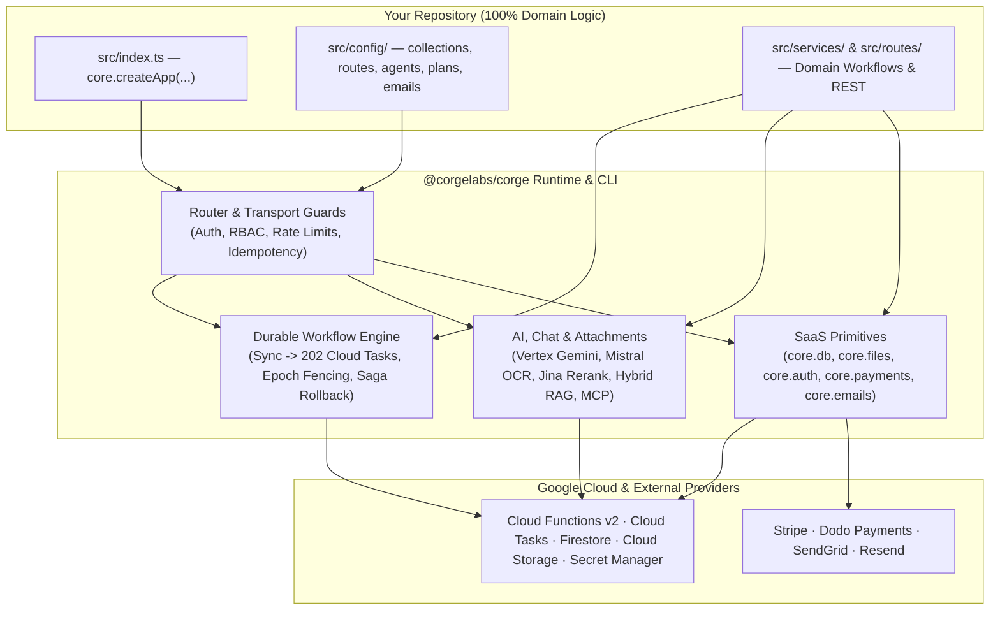

<div align="center">

# ⚡ Corge (`@corgelabs/corge`)

**The Zero-Boilerplate AI & Durable Workflow Backend-in-a-Box for GCP Cloud Functions v2.**

[](https://www.npmjs.com/package/@corgelabs/corge)
[](https://nodejs.org)
[](https://www.typescriptlang.org)
[](https://cloud.google.com/functions)
[](https://opensource.org/licenses/MIT)

[Why Corge?](#-why-corge-stop-writing-glue-code) · [30-Second Quickstart](#-30-second-quickstart) · [4 Architectural Pillars](#-the-4-architectural-pillars) · [Built for AI Coding Agents](#-built-for-ai-coding-agents) · [CLI Reference](#-built-in-corge-cli) · [Full SDK Spec](./docs/SDK_SPEC.md)

</div>

---

## 🔥 Why Corge? Stop Writing Glue Code.

Modern AI SaaS backends drown in **10,000+ lines of infrastructure plumbing** before shipping a single product feature: stitching together Hono/Express routers, Vercel AI / LangChain streams, BullMQ / Temporal durable workers, Stripe / Dodo webhook verifiers, SendGrid / Resend email templates, Firebase Auth sessions, and GCS signed URLs.

**Corge collapses the entire stack into a single `core` singleton.**

Your repository contains **100% pure domain business logic**—declarative Zod schemas, routes, agents, and services—while `@corgelabs/corge` handles distributed durability, multi-tenant zero-trust security, multimodal AI orchestration, billing, and one-command Cloud Functions v2 deployment.

| Layer | Traditional DIY Stack (10+ Packages & Glue) | With `@corgelabs/corge` |
| :--- | :--- | :--- |
| **HTTP, SSE & Guardrails** | Hono + custom CORS, rate limiters, body limits, auth middleware | `core.createApp()` + `core.define.routes()` |
| **Durable Workflows** | Temporal / Inngest / BullMQ + Redis + custom retry & rollback code | `mode: 'workflow'` + `useCore().step()` with Saga rollback |
| **Multimodal AI & RAG** | Vercel AI SDK + custom OCR + vector DB + custom MCP server | `core.ai`, `core.chat`, `core.attachments` + opt-in `/api/mcp` |
| **Database & Tenant RBAC** | Raw `firebase-admin/firestore` + manual converters & ownership checks | `core.db` + `core.define.collections()` (Zod strict + RBAC) |
| **Object Storage** | Raw `@google-cloud/storage` + manual MIME & tenant validation | `core.files` (`{userId}_{sha256}` content-addressed $O(1)$ ACLs) |
| **Auth & Sessions** | Custom JWTs, OAuth state, password reset tokens, revocation lists | `core.auth` (Cookies, Google/Apple OIDC, 3s revocation watermark) |
| **Subscriptions & Metering** | Stripe / Dodo SDKs + webhook HMAC + custom token quota counters | `core.payments` (Plans, Products, Webhooks, AI Token Quotas) |
| **Transactional Emails** | SendGrid / Resend SDKs + bounce webhooks + suppression tables | `core.emails` (Zod templates, FileRef attachments, auto-suppression) |
| **Build, Dev & Deploy** | Custom `esbuild` scripts, Secret Manager loaders, `firebase.json` hacks | `npx corge dev` · `corge build` · `corge deploy` · `corge test` |



---

## 🚀 30-Second Quickstart

### 1. Install & Scaffold

```bash
npm install @corgelabs/corge
npx corge init
```

### 2. Define Your App (`src/index.ts`)

```ts
import { core } from '@corgelabs/corge'
import { z } from 'zod'

const collections = core.define.collections({
  invoice: core.define.collection({
    schema: z.strictObject({
      id: core.schemas.entryId,
      userId: core.schemas.entryId,
      vendor: z.string(),
      totalCents: z.number().int().nonnegative()
    }),
    rbac: { user: ['create', 'read', 'list'], admin: ['create', 'read', 'update', 'delete', 'list'] }
  })
})

const routes = core.define.routes({
  'extract-invoice': core.define.route({
    mode: 'workflow',
    method: 'POST',
    path: '/invoices/extract',
    description: 'Extracts structured invoice fields from an uploaded PDF and records a ledger entry',
    mcp: true,
    input: z.strictObject({ fileRef: core.schemas.fileRef }),
    handler: async ({ input, step }) => {
      const { ai, db, userId } = core

      const extracted = await step('vision-extract', () =>
        ai.vision({
          fileRef: input.fileRef,
          prompt: 'Extract vendor name and total amount in cents.',
          schema: z.object({ vendor: z.string(), totalCents: z.number().int() })
        })
      )

      const record = await step('persist-invoice', {
        fn: () => db.create('invoice', { userId, ...extracted.output }),
        rollback: async () => {
          // Automatic reverse-order Saga compensation on downstream failure or task cancellation
        }
      })

      return record
    }
  })
})

export const { app, devApp, functions } = core.createApp({
  collections,
  routes
})
```

### 3. Develop, Test & Deploy

```bash
# Start local Hono server with live watch mode + automatic GCP Secret Manager injection
npx corge dev

# Typecheck (<1s via pre-built .d.ts with F12 source maps straight into Corge's TypeScript source)
npx corge check

# Bundle app + @corgelabs/corge into dist/index.cjs and deploy to Cloud Functions v2
npx corge deploy dev
npx corge deploy prod
```

---

## 🏛️ The 4 Architectural Pillars

### 1. Adaptive `200`/`202` Durable Workflows & Saga Rollbacks
Every route with `mode: 'workflow'` runs through Corge's durable execution engine:
- **Adaptive Sync-to-Async Promotion**: Starts executing synchronously. If the workflow finishes within the sync window (`syncTimeoutSeconds`), the caller gets an immediate `200 OK`. If it takes longer (or ` Prefer: respond-async` is sent), Corge seamlessly detaches and returns `202 Accepted` with `{ taskId, status: 'running' }` while Cloud Tasks continues execution in the background.
- **Per-Step Firestore Checkpointing (`step()`)**: Completed steps are memoized in `_tasks/{taskId}`. Retries and continuations replay completed steps in `0ms`.
- **Monotonic Epoch Fencing**: Every worker claim increments `epoch`. Zombie or hedged workers attempting to commit with a stale epoch are fenced immediately via `StaleWorkerEpochError`.
- **75% Deadline Auto-Yield**: Before a Cloud Function hits its wall-clock deadline, Corge checkpoints progress and dispatches a continuation task to Cloud Tasks.
- **Reverse-Order Saga Compensation**: Register `rollback` handlers on any `step()` or run parallel branches via `step.allWithRollback([...])`—if a downstream step fails or `DELETE /api/tasks/:taskId` cancels the workflow, completed steps are compensated in reverse order with crash-safe checkpointing.

```ts
const { step } = useCore()

const [crmRecord, billingRecord] = await step.allWithRollback([
  {
    name: 'provision-crm',
    fn: () => provisionCrmTenant(userId),
    rollback: (crm) => deleteCrmTenant(crm.id)
  },
  {
    name: 'provision-billing',
    fn: () => core.payments.subscribe({ planId: 'pro' }),
    rollback: (sub) => core.payments.cancelSubscription({ subscriptionId: sub.subscriptionId, immediate: true })
  }
])
```

---

### 2. Multimodal AI Agents, Hybrid RAG & Opt-In MCP
- **`core.ai`**: Unified interface over **Vertex AI (Gemini 2.5 Pro / Flash)**, **Mistral (`mistral-ocr-latest`)**, and **Jina (`jina-embeddings-v3` + `jina-reranker-v2-base-multilingual`)** wrapped in distributed circuit breakers and singleflight deduplication:
  - `core.ai.generate({ prompt, schema, system, tier })` — Structured Zod output or text generation with automatic Vertex ↔ Mistral fallback.
  - `core.ai.vision({ fileRef, prompt, schema })` — Multimodal document/image extraction.
  - `core.ai.decide({ query, questions })` — Parallel boolean/enum intent classification via `@typesafe-ai/sdk`.
  - `core.ai.embed(text)` & `core.ai.rerank(query, docs)` — 768-dim embeddings & cross-encoder reranking.
- **`core.chat` & `core.define.agents()`**:
  - Multi-agent registry with per-agent system prompts, allowed workflow tools, InfoBase markdown context (`core.define.context()`), and dynamic user context resolvers.
  - **Hybrid Vector + Keyword RAG (`core.chat.retrieveHybrid`)**: Combines Firestore vector nearest-neighbor search (`embedding`) with lexical scoring and Jina reranking.
  - **Dual Streaming Protocols**: Native `/api/chat/stream` SSE and OpenAI-compatible `/api/v1/chat/completions` (`stream: true | false`) with stream cancellation (`/api/chat/:chatId/cancel`).
  - **Opt-In Model Context Protocol (`/api/mcp`)**: Any workflow route marked with `mcp: true` is automatically exposed as a JSON-RPC 2.0 MCP tool with Zod-to-JSON-Schema input validation.

---

### 3. Batteries-Included SaaS Engine (`db`, `files`, `auth`, `payments`, `emails`)

#### `core.db` — Schema-Driven Firestore with RBAC & User Connectors
- Every collection is defined with `z.strictObject()` and receives an automatic `FirestoreDataConverter<T>`.
- Built-in tenant isolation (`userId === caller.userId`), soft-delete (`deleted: true`), cursor pagination, strip-on-update for immutable/owner fields, and automatic GDPR erasure (`cascadeEraseUserCollections`).

#### `core.files` & `core.attachments` — Content-Addressed Storage & Magic-Byte Verification
- File IDs are content-addressed (`{userId}_{sha256_prefix}`), enabling **$O(1)$ tenant ownership checks** before touching Firestore or GCS.
- Enforces magic-byte signature verification (rejecting spoofed HTML/scripts disguised as PDF/PNG/JPEG) and caches OCR/vision scan results by SHA-256 across uploads.

#### `core.auth` — Zero-Trust Sessions, OIDC & Cluster-Wide Revocation
- Firebase Auth + HTTP-only session cookies, Google & Apple RS256 OIDC sign-in (`signInSocial`), email verification, recovery emails, password reset, and two-tier token cache with a **3-second cluster-wide Firestore revocation watermark**.

#### `core.payments` — Subscriptions, One-Time Checkouts & AI Token Quota Metering
- First-class **Stripe** and **Dodo Payments** adapters with automatic `isDev` sandbox switching, timing-safe HMAC webhook verification (`/api/payments/webhooks/:provider`), idempotent ledger (`payment_transaction`), and **automatic AI token quota enforcement** per subscription tier.

#### `core.emails` — Typed Transactional Emails, Batching & Bounce Suppression
- First-class **SendGrid** and **Resend** adapters, Zod-validated dynamic templates (`core.define.emailTemplates()`), `FileRef` attachments pulled straight from `core.files`, idempotency locks, and HMAC webhook handlers (`/api/emails/webhooks/:provider`) that automatically populate `email_suppression` on hard bounces or spam complaints.

---

### 4. AI-Native DX & Zero-Token Cloud Build

```text
my-saas-backend/
├── .env                    # Empty keys auto-resolved from GCP Secret Manager by `corge`
├── firebase.json           # Standard Firebase config
├── package.json            # Only 1 runtime dependency: "@corgelabs/corge"
├── tsconfig.json           # Extends "@corgelabs/corge/tsconfig.base.json"
└── src/
    ├── index.ts            # Exports core.createApp({ collections, routes, agents, ... })
    ├── config/             # Declarative schemas, routes, agents, plans, emails
    ├── context/            # Domain InfoBase markdown (.md) files
    ├── routes/             # Domain HTTP & durable workflow handlers
    └── services/           # Pure domain business logic
```

1. **Instant `<1s` Typecheck + `F12` Into Raw TypeScript Source**:
   `@corgelabs/corge` ships both pre-compiled `dist/*.d.ts` + `dist/*.d.ts.map` **and** `src/**/*.ts` inside the npm tarball. Consumer `tsc --noEmit` runs in under a second while pressing **`F12` (Go to Definition)** in VS Code / Cursor / Antigravity opens the actual `.ts` implementation inside `node_modules/@corgelabs/corge/src/`.
2. **Self-Bundling Cloud Functions Compiler (Zero GCP Cloud Build Auth Failures)**:
   `corge build` bundles `@corgelabs/corge` directly into `dist/index.cjs` while keeping public npm packages external. During `corge deploy`, the CLI merges Corge's base Firestore/Storage rules & vector indexes with your project's rules and temporarily expands public runtime dependencies into `package.json`—so Google Cloud Build never needs a private `.npmrc` token.

---

## 🤖 Built for AI Coding Agents

`@corgelabs/corge` ships its complete machine-readable specification inside the npm package at `node_modules/@corgelabs/corge/docs/SDK_SPEC.md` (`@corgelabs/corge/spec`).

Add this rule to your consumer repository's `AGENTS.md`, `.cursorrules`, or `.gemini/GEMINI.md` so your coding agent writes 100% idiomatic Corge code on the first try:

```markdown
## Corge SDK (`@corgelabs/corge`) Rules
- Before creating or modifying routes, collections, agents, workflows, payments, or emails, read `node_modules/@corgelabs/corge/docs/SDK_SPEC.md`.
- Import `core` and `useCore` from `@corgelabs/corge`.
- Keep all consumer code strictly declarative (`core.define.{collections,routes,agents,plans,products,emailTemplates}`) and wrap multi-step side effects inside `useCore().step()` with `rollback` handlers where applicable.
```

---

## 🛠️ Built-In `corge` CLI

| Command | Description |
| :--- | :--- |
| **`npx corge init`** | Scaffolds a clean consumer project (`tsconfig.json`, `src/index.ts`, `src/config/`, `src/routes/`, `src/services/`). |
| **`npx corge dev`** | Resolves `.env` + empty secrets from GCP Secret Manager, bundles `src/index.ts` in `esbuild` watch mode, and starts a hot-reloading Hono server on `PORT` (default `8080`). |
| **`npx corge build`** | Bundles `src/index.ts` + `@corgelabs/corge` into `dist/index.cjs` (`node24`, CJS, sourcemap) ready for Cloud Functions v2. |
| **`npx corge deploy <prod\|dev>`** | Enforces git branch guard (`main` for `prod`, `dev` for `dev`), runs `corge build`, merges Corge's base Firestore/Storage rules & indexes, expands runtime deps, and deploys via `firebase-tools`. |
| **`npx corge test`** | Bundles and executes the E2E contract & integration test suite (`node --test`) with GCP Secret Manager injection. |
| **`npx corge check`** | Runs `tsc --noEmit` in the workspace. |
| **`npx corge link [path]`** | Symlinks a local checkout of `corgelabs/corge` into `node_modules/@corgelabs/corge` for instant live multi-repo editing (`npx corge unlink` restores the npm version). |
| **`npx corge env -- <cmd>`** | Runs any arbitrary command with `.env` + GCP Secret Manager secrets injected into `process.env`. |

---

## 📄 License

MIT © [Corge Labs](https://github.com/corgelabs)
