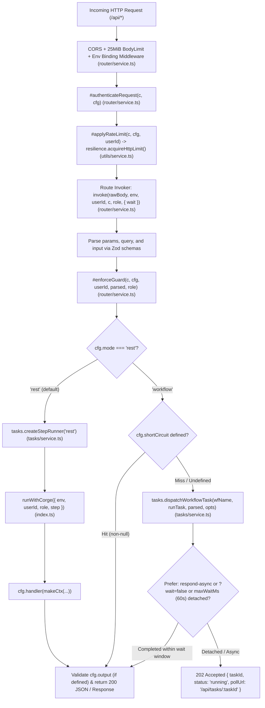
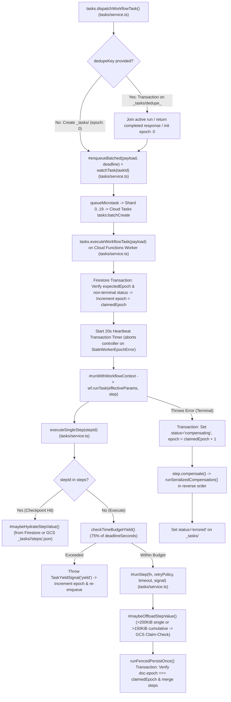
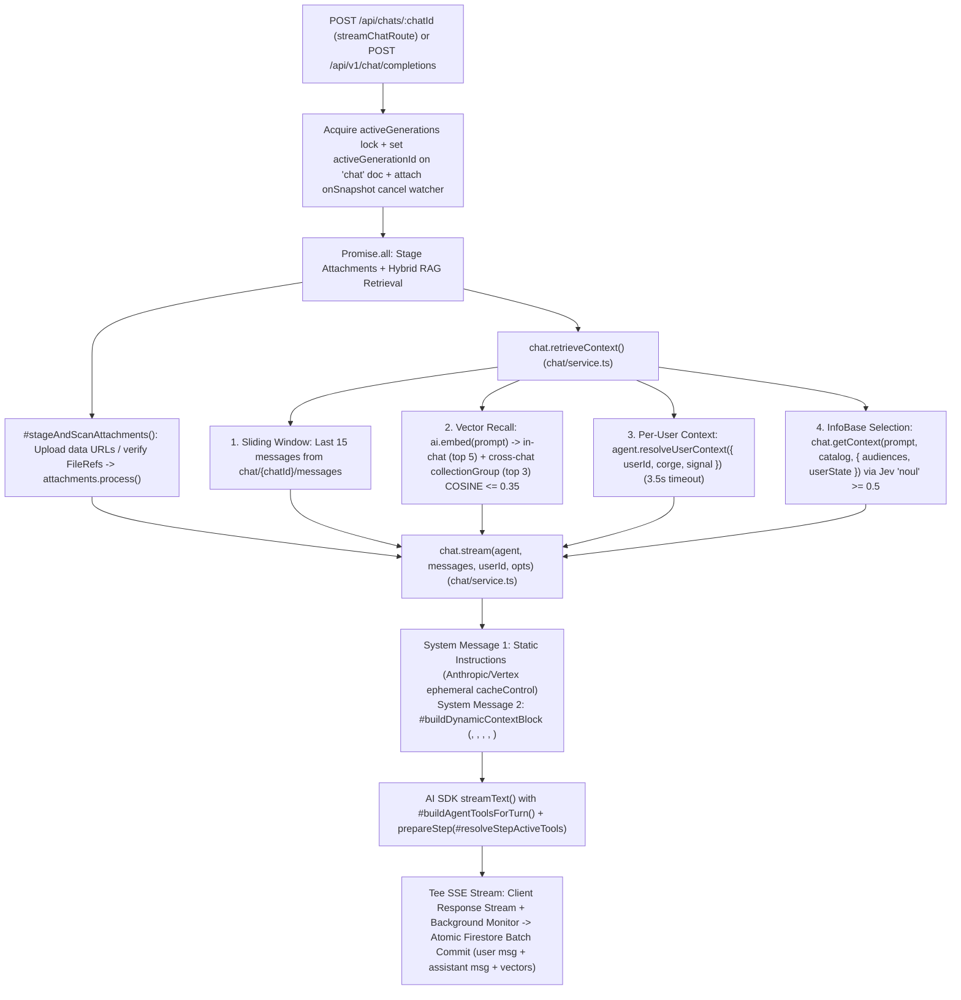
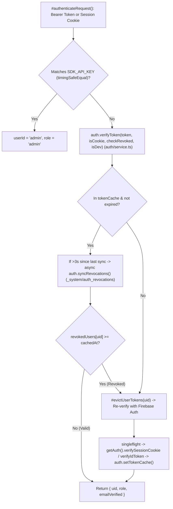

# Corge (`@corgelabs/corge`) — Complete Architecture, Methods Map & Per-Function Specification (`SPEC.md`)

> **Version**: 2.3 (Flat Domain Barrel & `<= 500 LOC` Class-Composed Architecture, Methods Map & Per-Function Specification)  
> **Runtime Stack**: Node.js 24 LTS (`nodejs24` GA on Cloud Functions 2nd Gen) · Hono · Cloud Tasks · Cloud Firestore Enterprise · Firebase Storage · Vertex AI (`claude-haiku-5-5`, `claude-sonnet-4-5`, `text-embedding-005`) · Mistral OCR (`mistral-ocr-latest`) · TypeSafe Jev (`jev-latest`) · Jina Reader (`r.jina.ai`)

---

## Table of Contents

1. [Corge Design Philosophy & 4-Tier Visibility Model](#1-corge-design-philosophy--4-tier-visibility-model)
2. [Project & Module Topology (`src/` Flat Domain Barrel Map)](#2-project--module-topology-srccore-flat-domain-barrel-map)
3. [Master `CoreClient`, HTTP Route & Runtime State Lookup Matrices](#3-master-coreclient-http-route--runtime-state-lookup-matrices)
   - [3.1 Master `CoreClient` Public Surface Map (`corge.*` & `useCorge()`)](#31-master-coreclient-public-surface-map-corge--usecore)
   - [3.2 Master `corge.internals.*` Engine Hooks Map](#32-master-coreinternals-engine-hooks-map)
   - [3.3 Master Built-In HTTP Routes (`CORGE_ROUTE_DEFAULTS` — 51 Endpoints)](#33-master-built-in-http-routes-core_route_defaults--51-endpoints)
   - [3.4 Master In-Memory Registries, Caches & `AsyncLocalStorage` Stores](#34-master-in-memory-registries-caches--asynclocalstorage-stores)
4. [Subsystem Architecture & Call-Graph Diagrams (Mermaid)](#4-subsystem-architecture--call-graph-diagrams-mermaid)
   - [4.1 Request & Route Execution Pipeline (`rest` vs `workflow`)](#41-request--route-execution-pipeline-rest-vs-workflow)
   - [4.2 Durable Workflow Engine, Epoch Fencing & Saga Compensation](#42-durable-workflow-engine-epoch-fencing--saga-compensation)
   - [4.3 Attachment Scanning & Sharded Fan-Out Pipeline](#43-attachment-scanning--sharded-fan-out-pipeline)
   - [4.4 Declarative AI Agent, Hybrid RAG Context & Streaming Pipeline](#44-declarative-ai-agent-hybrid-rag-context--streaming-pipeline)
   - [4.5 Authentication, OIDC Social Login, Token Cache & Revocation Sync](#45-authentication-oidc-social-login-token-cache--revocation-sync)
5. [Entrypoint, Corge Class & Config Module (`index.ts`, `config.ts`) — Per-Function Spec](#5-entrypoint-corge-class--config-module-indexts-configts--per-function-spec)
6. [Database & RBAC Module (`src/db/*`) — Per-Function Spec](#6-database--rbac-module-srccoredb--per-function-spec)
7. [Files & Content-Addressed Storage Module (`src/files/*`) — Per-Function Spec](#7-files--content-addressed-storage-module-srccorefiles--per-function-spec)
8. [AI Primitives Module (`src/ai/*`) — Per-Function Spec](#8-ai-primitives-module-srccoreai--per-function-spec)
9. [Attachments Scanning & Batch Fan-Out Module (`src/attachments/*`) — Per-Function Spec](#9-attachments-scanning--batch-fan-out-module-srccoreattachments--per-function-spec)
10. [Authentication, OIDC Social & Account Recovery Module (`src/auth/*`) — Per-Function Spec](#10-authentication-oidc-social--account-recovery-module-srccoreauth--per-function-spec)
11. [Chat, Agents, InfoBase Context, MCP & OpenAI Module (`src/chat/*`) — Per-Function Spec](#11-chat-agents-infobase-context-mcp--openai-module-srccorechat--per-function-spec)
12. [Durable Workflows, StepRunner, Cloud Tasks & Watcher Module (`src/tasks/*`) — Per-Function Spec](#12-durable-workflows-steprunner-cloud-tasks--watcher-module-srccoretasks--per-function-spec)
13. [Router, Security Guards & Cloud Functions Module (`src/router/*`) — Per-Function Spec](#13-router-security-guards--cloud-functions-module-srccorerouter--per-function-spec)
14. [Resilience, Rate Limiting, Circuit Breaker & Error Utilities (`src/utils/*`) + End-to-End DX Examples](#14-resilience-rate-limiting-circuit-breaker--error-utilities-srccoreutils--end-to-end-dx-examples)
15. [Transactional Emails & Payments Modules (`src/emails/*`, `src/payments/*`) — Per-Function Spec](#15-transactional-emails--payments-modules-srccoreemails-srccorepayments--per-function-spec)

---

## 1. Corge Design Philosophy & 4-Tier Visibility Model

### 1.1 Single `@corge` Barrel + Ambient Context Propagation (`corge.*` & `useCorge()`)

1. **Single Public Entrypoint (`import { Corge, corge, useCorge } from '@corge'`)**:
   - `src/index.ts` is the sole public entrypoint defining `Corge`, `corge`, `useCorge`, and the `corge.types.*` namespace, composed directly from domain `*Service` classes (`ErrorsService`, `ResilienceService`, `DbService`, `FilesService`, `AiService`, `AttachmentsService`, `AuthService`, `ChatService`, `TasksService`, `RouterService`).
   - Application code (`src/config/*`, `src/routes/*`, `src/services/*`, `src/utils/*`, `src/index.ts`) imports exclusively from `@corge` and never reaches into internal sub-paths (`@corge/db/*`, `@corge/tasks/*`, etc.).
2. **Ambient Execution State via `AsyncLocalStorage` + Class Composition (`this.#corge`)**:
   - Every HTTP route, MCP tool invocation, AI agent tool call, and Cloud Tasks workflow worker executes inside `runWithCorge({ env, userId, role, step }, fn)`.
   - Calling `corge.<ns>.<method>()` on the singleton `corge` (or `const corgeClient = useCorge()`) dynamically resolves `#state` from `corgeStorage.getStore()` → `tasks.getActiveWorkflowStore()` → fallback dev/prod admin context with zero prop-drilling.
   - Each domain `*Service` class receives `corgeClient: Corge` in its constructor (`readonly #corge: Corge`), calling sibling services and reading `this.#corge.env`, `this.#corge.userId`, `this.#corge.role`, `this.#corge.caller`, and `this.#corge.step` directly without circular factory injection.

### 1.2 The 4-Tier Function Visibility Taxonomy

Every function, method, class, and closure across the flat domain barrel files in `src/` belongs to one of four strict architectural tiers:

| Tier | Badge | Access Path | Architectural Role |
| :--- | :--- | :--- | :--- |
| **Tier 1** | `Public (corge.*)` | `corge.<ns>.<fn>` / `useCorge().<ns>.<fn>` | Primary surface for application developers (`createApp`, `define.*`, `db.*`, `files.*`, `ai.*`, `attachments.*`, `tasks.*`, `auth.*`, `chat.*`, `step.*`, `schemas.*`, `errors.*`, `types.*`). |
| **Tier 2** | `Internal Hook (corge.internals.*)` | `corge.internals.<group>.<fn>` | Non-enumerable getter on `Corge.prototype` exposing low-level resilience (`singleflight`, `circuitBreaker`, `acquireLimit`), context runners, registries, workflow engine primitives, and auth token/revocation internals for advanced orchestration and test harnesses. |
| **Tier 3** | `Domain Barrel Export (<domain>/index.ts)` | `export class *Service` / `export * from './schema'` | Domain `<domain>/index.ts` barrels imported exclusively by `src/index.ts` and cross-domain callers (`'../<domain>'`), re-exporting `*Service`, public `schema.ts` symbols, and `corge*Routes`. |
| **Tier 4** | `Private (#method / Flat Sibling)` | `#method` on `*Service` or flat sibling sub-engine | Encapsulated `#private` class methods and domain-internal flat sibling files (`tasks/{steps,watcher,worker}.ts`, `auth/{session,oidc,recovery}.ts`, `chat/{context,stream}.ts`, `router/guard.ts`, `<domain>/utils.ts`). |

### 1.3 Unified Capabilities (`defineRoute`: `'rest'` vs `'workflow'`)

Every route declared with `corge.define.route()` / `corge.define.routes()` is mounted under `/api/${routeKey}` regardless of `mode: 'rest' | 'workflow'`:
- **`mode: 'rest'` (default)**: Executes inline within the HTTP request using an in-memory `StepRunner` (`createStepRunner('rest')`) providing in-memory memoization, step retries/timeouts, and reverse-order Saga compensation on failure. When `idempotencyKey` or the `Idempotency-Key` HTTP header is supplied, concurrent identical calls coalesce via `singleflight` and completed JSON outcomes are persisted in `_idempotency/{keyHash}` (24h TTL).
- **`mode: 'workflow'`**: Executes durably over sharded Cloud Tasks (`0..19`) + Firestore `_tasks/{taskId}` with monotonic epoch fencing (`epoch`, `activeRunId`, `lastHeartbeatAt`), automatic `> 200 KiB` (or `> 150 KiB` cumulative) GCS Claim-Check offloading, `step.map`, `step.sleep`, `step.waitForSignal`, `step.continueAsNew`, 75% time-budget continuation yielding, and synchronous HTTP watching (`watchTask`) that gracefully detaches to `202 Accepted` when `Prefer: respond-async`, `?wait=false`, or `maxWaitMs` (`60s`) is reached.

---

## 2. Project & Module Topology (`src/` Flat Domain Barrel Map)

Every domain in `src/<domain>/` is a flat directory (`0` nested subdirectories), with every `.ts` file strictly `<= 500 LOC`, every method `<= 100 LOC`, pure `schema.ts` files (zero runtime helper functions), and a `<domain>/index.ts` public domain barrel so all cross-domain imports resolve exclusively via `'../<domain>'` or `'./<domain>'`:

```text
src/
├── index.ts                      # [Entrypoint & Client] Corge class composed from *Service classes, ALS state (corgeStorage), corge singleton, corge.types namespace, useCorge()
├── config.ts                     # [Config] CORGE_CONFIG, defineConfig(), SECRET_NAMES, CoreConfig/AppBindings/RbacConfig types
├── ai/
│   ├── index.ts                  # [AI Barrel] Re-exports schema, AiService
│   ├── schema.ts                 # [AI] Pure types & schemas (JevQuestion, DecideResult, VisionOptions, VisionResult, AiGenerateOptions, AiGenerateResult)
│   ├── utils.ts                  # [AI] Pure prompt builders (buildVisionFallbackPrompt)
│   └── service.ts                # [AI] AiService (decide, vision, generate, embed) + Mistral OCR, TypeSafe Jev & Vertex Anthropic clients
├── attachments/
│   ├── index.ts                  # [Attachments Barrel] Re-exports schema, AttachmentsService, coreAttachmentsRoutes
│   ├── schema.ts                 # [Attachments] Pure Zod schemas, types & AttachmentTypeSpec registry
│   ├── utils.ts                  # [Attachments] schemaFor(), parseFields(), extractAttachmentTasks(), DEFECT_QUESTIONS
│   ├── service.ts                # [Attachments] AttachmentsService (scan, process, classify, scanShortCircuit)
│   └── routes.ts                 # [Attachments] coreAttachmentsRoutes ('attachments.scan', 'attachments.process')
├── auth/
│   ├── index.ts                  # [Auth Barrel] Re-exports schema, AuthService, coreAuthRoutes
│   ├── schema.ts                 # [Auth] Pure Zod schemas & static types (AuthUser, AuthTokenDoc, LinkedProvider)
│   ├── utils.ts                  # [Auth] resolveUserRole(), hashToken(), mapUserRecord(), parseJwtSegment()
│   ├── session.ts                # [Auth] AuthSessionEngine (LRU tokenCache, prod/dev revocation watermarks, session cookies, custom tokens)
│   ├── oidc.ts                   # [Auth] AuthOidcEngine (strict RS256 JWK verification, fail-closed claim check, account linking)
│   ├── recovery.ts               # [Auth] AuthRecoveryEngine (OTP/token issuance, email verification, password reset, account recovery)
│   ├── service.ts                # [Auth] AuthService facade + bounded GDPR eraseUser (runChunked 25)
│   └── routes.ts                 # [Auth] coreAuthRoutes (18 built-in authentication & user management route handlers)
├── chat/
│   ├── index.ts                  # [Chat Barrel] Re-exports schema, ChatService, coreChatRoutes, mcpRoute
│   ├── schema.ts                 # [Chat] Pure Zod schemas & static types (AgentConfig, UserContext, ChatMetadataDoc, ChatMessageDoc)
│   ├── utils.ts                  # [Chat] SSRF guard (isSafePublicUrl), message/attachment parsers, dynamic context & UI stream builders
│   ├── context.ts                # [Chat] ChatContextEngine (InfoBase Jev selector, vector recall, sliding window, userContext)
│   ├── stream.ts                 # [Chat] ChatStreamEngine (SSE turn execution, attachment staging, activeGenerations lock, cancel)
│   ├── service.ts                # [Chat] ChatService facade (stream, ask, retrieveContext, getContext, saveChat, messages, cancel)
│   └── routes.ts                 # [Chat] coreChatRoutes + MCP JSON-RPC handler (mcpRoute) + OpenAI-compatible endpoints
├── db/
│   ├── index.ts                  # [DB Barrel] Re-exports schema, DbService
│   ├── schema.ts                 # [DB] Pure Zod schemas, coreCollections (9 collections), collectionRegistry, defineCollection(s)
│   ├── utils.ts                  # [DB] Pure RBAC scope resolvers, Firestore normalizers, cursor pagination & runChunked helpers
│   └── service.ts                # [DB] DbService (prod/dev Firestore & Bucket singletons, getGcpAccessToken, RBAC CRUD, GDPR cascade)
├── emails/
│   ├── index.ts                  # [Emails Barrel] Re-exports schema, EmailsService, coreEmailRoutes
│   ├── schema.ts                 # [Emails] Pure Zod schemas, EmailTemplateDefinition, defineEmailTemplates, emailTemplateRegistry
│   ├── utils.ts                  # [Emails] Stateless Resend/SendGrid/Firebase OOB callers, Svix/Twilio HMAC-SHA256 webhook verifiers, template builders
│   ├── service.ts                # [Emails] EmailsService (send, sendBatch, sendAuthEmail, getLog, listLogs, isSuppressed, webhook processor)
│   └── routes.ts                 # [Emails] coreEmailRoutes ('emails.send', 'emails.batch', 'emails.logs', 'emails.webhook')
├── files/
│   ├── index.ts                  # [Files Barrel] Re-exports schema, FilesService, coreFilesRoutes
│   ├── schema.ts                 # [Files] Content-addressed FileRef (<userId>_<sha256_24>), magic-byte refined FileBody, SignedUploadInput
│   ├── utils.ts                  # [Files] canAccessFile() O(1) prefix check & hasValidMagicBytes() signature validator
│   ├── service.ts                # [Files] FilesService (SDK-level #assertAccess RBAC, upload with Saga rollback, V4 signed URLs, CRUD)
│   └── routes.ts                 # [Files] coreFilesRoutes ('files.list', 'files.upload', 'files.get', 'files.delete')
├── payments/
│   ├── index.ts                  # [Payments Barrel] Re-exports schema, PaymentsService, corePaymentRoutes
│   ├── schema.ts                 # [Payments] Pure Zod schemas, PlanDefinition, ProductDefinition, definePlans, defineProducts & registries
│   ├── utils.ts                  # [Payments] Stateless Stripe/Dodo REST helpers, encodeStripeForm, HMAC-SHA256 webhook verifiers & normalizers
│   ├── billing.ts                # [Payments] PaymentsBillingEngine (ensureCustomer, applyProductGrants, createCheckout, createPaymentLink, createInvoice, charge, subscribe, changeSubscriptionTier, cancelSubscription)
│   ├── service.ts                # [Payments] PaymentsService (billing facade, getSubscription, getUsage, checkQuota, recordUsage, meter ingestion & webhook processor)
│   └── routes.ts                 # [Payments] corePaymentRoutes (9 built-in payment, subscription, status & webhook routes)
├── router/
│   ├── index.ts                  # [Router Barrel] Re-exports schema, RouterService
│   ├── schema.ts                 # [Router] RouteConfig, RouteExecutionContext, ResourceGuardConfig, defineRoute(s), CORGE_ROUTE_DEFAULTS (51 routes)
│   ├── guard.ts                  # [Router] RouterGuardEngine (rate limiting, authenticateRequest, enforceGuard, withHttpIdempotency)
│   └── service.ts                # [Router] RouterService (route invoker, REST + workflow dispatch, Hono apps, createCloudFunctions)
├── tasks/
│   ├── index.ts                  # [Tasks Barrel] Re-exports schema, TasksService, task/health/introspection route builders
│   ├── schema.ts                 # [Tasks] Pure types & signal classes (StepRunner, TaskStatusRecord, StaleWorkerEpochError, TaskYieldSignal)
│   ├── utils.ts                  # [Tasks] Pure predicates, Cloud Tasks queue helpers, retry runner & Firestore epoch transactions
│   ├── steps.ts                  # [Tasks] TaskStepsEngine (createStepRunner, GCS Claim-Check offload/hydrate, fenced step persistence)
│   ├── watcher.ts                # [Tasks] TaskWatcherEngine (sharded Cloud Tasks dispatcher, multiplexed onSnapshot + poll + hedge watcher)
│   ├── worker.ts                 # [Tasks] TaskWorkerEngine (dispatch, execute, monotonic epoch fencing, 20s heartbeat, yield & compensation)
│   ├── service.ts                # [Tasks] TasksService facade (status, signal, cancel, step/workflow internals)
│   └── routes.ts                 # [Tasks] Health check, /api/routes JSON+Markdown introspection generator, task status/signal/cancel routes
└── utils/
    ├── index.ts                  # [Utils Barrel] Re-exports schema, ErrorsService, ResilienceService
    ├── schema.ts                 # [Utils] BreakerName, CircuitState, CircuitBreakerDoc, SingleflightScope, SingleflightOptions, errorBodySchema
    └── service.ts                # [Utils] ErrorsService & ResilienceService (singleflight, #private RateLimiter reading CORGE_CONFIG.limits.buckets, circuitBreaker)
```

---

## 3. Master `CoreClient`, HTTP Route & Runtime State Lookup Matrices

### 3.1 Master `CoreClient` Public Surface Map (`corge.*` & `useCorge()`)

| Public SDK Path | Source File | Backing Implementation | Signature Summary | Purpose |
| :--- | :--- | :--- | :--- | :--- |
| **`Corge`** | `src/index.ts` | `class Corge` | `new Corge(state?: CorgeRuntimeState)` | Context-aware SDK client class composed of domain `*Service` instances. |
| **`corge`** | `src/index.ts` | `new Corge()` | `const corge: Corge` | Default ambient singleton + merged `corge.types.*` namespace. |
| **`useCorge()`** | `src/index.ts` | `useCorge` | `() => Corge` | Returns `new Corge(active)` if inside ALS store, else `corge` singleton. |
| **`corge.env`** | `src/index.ts` | `Corge.prototype.env` | `get env(): AppBindings` | Active secret bindings & `isDev` flag. |
| **`corge.userId`** | `src/index.ts` | `Corge.prototype.userId` | `get userId(): EntryId` | Authenticated caller UID (or `'admin'` / `''`). |
| **`corge.role`** | `src/index.ts` | `Corge.prototype.role` | `get role(): DbRole` | Caller RBAC role (`'admin' \| 'user' \| 'anon'`). |
| **`corge.caller`** | `src/index.ts` | `Corge.prototype.caller` | `get caller(): { userId: EntryId; role: DbRole }` | Tuple object passed to task/chat ownership checks. |
| **`corge.step`** | `src/index.ts` | `Corge.prototype.step` | `get step(): StepRunner` | Active `StepRunner` from `#state.step` or `TasksService.useStep()`. |
| **`corge.config`** | `src/config.ts` | `CORGE_CONFIG` | `readonly config: CoreConfig` | Live mutable platform configuration singleton. |
| **`corge.createApp`** | `src/router/service.ts` | `RouterService.createApp` | `(opts?: CorgeAppInit) => CoreAppReturn` | Compiles collections, agents, context, routes, Hono apps, and Cloud Functions. |
| **`corge.define.config`** | `src/config.ts` | `defineConfig` | `(overrides?: DeepPartial<CoreConfig>) => CoreConfig` | Deep-merges config overrides and recomputes GCP URIs/buckets if `gcpProject` changes. |
| **`corge.define.route`** | `src/router/schema.ts` | `defineRoute` | `<C extends RouteConfig>(config: C) => C` | Declares a typed HTTP/Workflow/Agent/MCP route (defaults `mcp: false`). |
| **`corge.define.routes`** | `src/router/schema.ts` | `defineRoutes` | `<T extends Record<string, RouteConfig>>(routes: T) => T` | Declares a map of domain routes. |
| **`corge.define.routeOverrides`** | `src/router/schema.ts` | `defineRouteOverrides` | `<T extends CorgeRouteOverrides>(overrides: T) => T` | Customizes `auth`, `rateLimit`, `guard`, `mcp`, `tool`, `timeout`, `retry` on built-in routes. |
| **`corge.define.collection`** | `src/db/schema.ts` | `defineCollection` | `<S extends z.ZodObject<any>>(def: CollectionDefinition<S>) => CollectionDefinition<S>` | Merges `BaseEntryFields` (`id`, `deleted`, `createdAt`, `updatedAt`) and normalizes `userRelation`. |
| **`corge.define.collections`** | `src/db/schema.ts` | `defineCollections` | `<T extends Record<string, CollectionDefinition<any>>>(defs: T) => T` | Declares a map of typed Firestore collections. |
| **`corge.define.agent`** | `src/chat/schema.ts` | `defineAgent` | `<C extends AgentConfig>(config: C) => C` | Declares a single AI agent configuration. |
| **`corge.define.agents`** | `src/chat/schema.ts` | `defineAgents` | `<T extends Record<string, AgentConfig>>(agents: T) => T` | Declares a map of AI agents. |
| **`corge.define.context`** | `src/chat/schema.ts` | `defineContext` | `<const T extends readonly ContextItemSpec[]>(items: T) => T` | Declares the Agent InfoBase `.md` documentation catalog. |
| **`corge.define.attachmentTypes`** | `src/attachments/schema.ts` | `defineAttachmentTypes` | `<T extends AttachmentTypesMap>(types: T) => T` | Declares document classification & extraction Zod schemas. |
| **`corge.define.emailTemplates`** | `src/emails/schema.ts` | `defineEmailTemplates` | `<T extends EmailTemplatesMap>(templates: T) => T` | Declares typed transactional email templates with Zod `variables`, `onBeforeSend`, and provider specs. |
| **`corge.define.plans`** | `src/payments/schema.ts` | `definePlans` | `<T extends PlansMap>(plans: T) => T` | Declares recurring/free subscription tiers with provider price/product IDs, AI token limits, and overage specs. |
| **`corge.define.products`** | `src/payments/schema.ts` | `defineProducts` | `<T extends ProductsMap>(products: T) => T` | Declares one-time purchasable products & token/credit packs with automatic `grants`. |
| **`corge.db.create`** | `src/db/service.ts` | `DbService.create` | `<N>(name: N, data: InsertData<N>, ctx?: DbCallContext) => Promise<SelectModel<N>>` | Validates schema, checks RBAC `'create'` permission, and writes new Firestore doc. |
| **`corge.db.read`** | `src/db/service.ts` | `DbService.read` | `<N>(name: N, id: EntryId, includeDeleted?: boolean, ctx?: DbCallContext) => Promise<SelectModel<N> \| undefined>` | Reads doc by ID, normalizes Timestamps, and enforces RBAC `'read'` scope. |
| **`corge.db.list`** | `src/db/service.ts` | `DbService.list` | `<N>(name: N, options?: DbListOptions<SelectModel<N>>, ctx?: DbCallContext) => Promise<PaginatedList<SelectModel<N>>>` | Queries/batches docs with RBAC auto-scoping, index-fallback sorting, and `nextCursor`. |
| **`corge.db.listPage`** | `src/db/service.ts` | `DbService.listPage` | `<N>(name: N, options?: DbListOptions<SelectModel<N>>, ctx?: DbCallContext) => Promise<DbListPage<SelectModel<N>>>` | Wraps `list` returning explicit `{ items, nextCursor }`. |
| **`corge.db.update`** | `src/db/service.ts` | `DbService.update` | `<N>(name: N, id: EntryId, patch: UpdateData<N>, ctx?: DbCallContext) => Promise<{ id: EntryId; updated: true }>` | Strips immutable/owner fields, validates partial schema, enforces RBAC `'write'`, updates doc. |
| **`corge.db.delete`** | `src/db/service.ts` | `DbService.delete` | `<N>(name: N, id: EntryId, ctx?: DbCallContext) => Promise<{ id: EntryId; deleted: true }>` | Soft-deletes doc (`deleted: true`) after RBAC `'delete'` check. |
| **`corge.db.hardDelete`** | `src/db/service.ts` | `DbService.hardDelete` | `<N>(name: N, id: EntryId, ctx?: DbCallContext) => Promise<{ id: EntryId; deleted: true; hard: true }>` | Permanently deletes doc, GCS file/chat subcollections, and runs `onHardDelete` hook. |
| **`corge.db.canAccess`** | `src/db/service.ts` | `DbService.canAccess` | `<N>(name: N, doc: SelectModel<N>, userId?: EntryId, action?: DbAction, role?: DbRole) => Promise<boolean>` | Evaluates RBAC matrix (`any` vs `own` + `#isEntryOwner`) for `doc`. |
| **`corge.db.firestore`** | `src/db/service.ts` | `DbService.firestore` | `(isDev?: boolean) => Firestore` | Returns raw `firebase-admin/firestore` instance for prod or dev DB. |
| **`corge.files.upload`** | `src/files/service.ts` | `FilesService.upload` | `(input: FileBody, userId?: EntryId) => Promise<{ ref: FileRef }>` | Content-addressed upload (`<userId>_<sha256_24>`) to GCS + `file` collection with Saga rollback. |
| **`corge.files.getSignedUploadUrl`** | `src/files/service.ts` | `FilesService.getSignedUploadUrl` | `(input: SignedUploadInput, userId?: EntryId, expiresInMs?: number) => Promise<SignedUploadUrlResult>` | Generates V4 GCS signed `PUT` URL with automatic SHA-256 deduplication check. |
| **`corge.files.getSignedDownloadUrl`** | `src/files/service.ts` | `FilesService.getSignedDownloadUrl` | `(ref: FileRef, expiresInMs?: number) => Promise<SignedDownloadUrlResult>` | Verifies `file` metadata exists and generates V4 GCS signed `GET` URL. |
| **`corge.files.get`** | `src/files/service.ts` | `FilesService.get` | `(ref: FileRef) => Promise<FileBody>` | Downloads file bytes + metadata in parallel and validates `FileBody`. |
| **`corge.files.list`** | `src/files/service.ts` | `FilesService.list` | `(options?: DbListOptions<SelectModel<'file'>>) => Promise<PaginatedList<SelectModel<'file'>>>` | Lists `file` metadata records (auto-scoped to `corge.userId` for non-admins). |
| **`corge.files.download`** | `src/files/service.ts` | `FilesService.download` | `(ref: FileRef) => Promise<Buffer>` | Downloads raw `Buffer` from Firebase Storage bucket. |
| **`corge.files.delete`** | `src/files/service.ts` | `FilesService.delete` | `(ref: FileRef) => Promise<{ ref: FileRef; deleted: true }>` | Soft-deletes `file` metadata record in Firestore. |
| **`corge.files.hardDelete`** | `src/files/service.ts` | `FilesService.hardDelete` | `(ref: FileRef) => Promise<{ ref: FileRef }>` | Permanently deletes file from GCS and Firestore inside a reversible `step` with rollback. |
| **`corge.files.canAccess`** | `src/files/service.ts` | `FilesService.canAccess` | `(ref: string, userId?: EntryId) => boolean` | $O(1)$ prefix check verifying `ref.slice(0, -25) === userId` (or admin). |
| **`corge.files.bucket`** | `src/files/service.ts` | `FilesService.bucket` | `(isDev?: boolean) => Bucket` | Returns raw Firebase Storage `Bucket` instance for prod or dev. |
| **`corge.ai.vision`** | `src/ai/service.ts` | `AiService.vision` | `(documentUrl: string, opts?: VisionOptions) => Promise<VisionResult>` | Mistral OCR + JSON Schema annotation + automatic Vertex Vision fallback under circuit breaker. |
| **`corge.ai.decide`** | `src/ai/service.ts` | `AiService.decide` | `(state: unknown, questions: Record<string, JevQuestion>) => Promise<DecideResult>` | TypeSafe Jev `systemOne` probabilistic reasoning (`noul`, `choice`, `score`) under circuit breaker. |
| **`corge.ai.generate`** | `src/ai/service.ts` | `AiService.generate` | `<O = string>(promptOrMessages: string \| ModelMessage[], opts?: AiGenerateOptions<O>) => Promise<AiGenerateResult<O>>` | Vertex Anthropic text or structured Zod output generation under circuit breaker. |
| **`corge.ai.embed`** | `src/ai/service.ts` | `AiService.embed` | `(text: string) => Promise<number[] \| null>` | Generates 768-dim embedding vector via Vertex `text-embedding-005` (null if `< 15` chars). |
| **`corge.attachments.scan`** | `src/attachments/service.ts` | `AttachmentsService.scan` | `(raw: ScanAttachmentInput, opts?: { types?: AttachmentTypesMap; step?: StepRunner }) => Promise<FileScan>` | Singleflight + cross-user SHA-256 cache + multi-step OCR → classify → extract → persist pipeline. |
| **`corge.attachments.process`** | `src/attachments/service.ts` | `AttachmentsService.process` | `(raw: ProcessAttachmentsInput, opts?: { types?: AttachmentTypesMap; step?: StepRunner }) => Promise<ProcessAttachmentsOutput>` | Batch preloads `file` docs and fans out `#scanAttachmentTask` via `step.map` with `shortCircuit`. |
| **`corge.attachments.classify`** | `src/attachments/service.ts` | `AttachmentsService.classify` | `(markdown: string, types?: AttachmentTypesMap) => Promise<{ attachmentType: string; confidence: number }>` | Classifies document markdown into a registered `AttachmentTypesMap` key via Jev `choice`. |
| **`corge.tasks.status`** | `src/tasks/service.ts` | `TasksService.status` | `<O = unknown>(taskId: string) => Promise<TaskStatusRecord<O>>` | Reads `_tasks/{taskId}`, enforces task ownership, and hydrates GCS Claim-Check response. |
| **`corge.tasks.signal`** | `src/tasks/service.ts` | `TasksService.signal` | `(taskId: string, signalName: string, payload?: unknown) => Promise<{ taskId: string; signaled: true }>` | Stores signal in `_tasks/{taskId}.signals`, increments `epoch` if waiting, and wakes workflow. |
| **`corge.tasks.cancel`** | `src/tasks/service.ts` | `TasksService.cancel` | `(taskId: string) => Promise<{ taskId: string; status: 'cancelled' }>` | Bumps `epoch` to `'compensating'`, aborts local worker or runs replay-only Saga compensation, marks `'cancelled'`. |
| **`corge.auth.getUser`** | `src/auth/service.ts` | `AuthService.getUser` | `(uid: EntryId) => Promise<AuthUser \| undefined>` | Fetches Firebase `UserRecord` + `user_auth_meta` doc in parallel and merges into `AuthUser`. |
| **`corge.auth.listUsers`** | `src/auth/service.ts` | `AuthService.listUsers` | `(includeDeleted?: boolean) => Promise<AuthUser[]>` | Lists up to 1,000 Firebase Auth users mapped to `AuthUser`. |
| **`corge.auth.setClaims`** | `src/auth/service.ts` | `AuthService.setClaims` | `(uid: EntryId, claims: Record<string, unknown> \| null) => Promise<void>` | Sets Firebase custom claims, evicts local token cache, and records global revocation watermark. |
| **`corge.auth.blockUser`** | `src/auth/service.ts` | `AuthService.blockUser` | `(userId?: EntryId, blocked?: boolean) => Promise<{ userId: EntryId; blocked: boolean; deleted: boolean }>` | Disables/enables Firebase Auth user, revokes refresh tokens, and updates `_system/auth_revocations`. |
| **`corge.auth.eraseUser`** | `src/auth/service.ts` | `AuthService.eraseUser` | `(raw: EraseUserInput, s?: StepRunner) => Promise<EraseUserOutput>` | Durable GDPR erasure: optional GCS Firestore export, cascade-deletes files/chats/collections/tasks/auth. |
| **`corge.auth.signInSocial`** | `src/auth/service.ts` | `AuthService.signInSocial` | `(input: SocialSignInInput) => Promise<{ user: AuthUser; sessionCookie: string }>` | Verifies Google/Apple OIDC ID token (with IdentityToolkit fallback), links account, and mints session. |
| **`corge.auth.sendVerificationEmail`** | `src/auth/service.ts` | `AuthService.sendVerificationEmail` | `(userId?: EntryId) => Promise<{ sent: true; expiresInMinutes: number }>` | Issues 6-digit OTP + 32-byte URL token in `auth_tokens` and dispatches verification email. |
| **`corge.auth.verifyEmail`** | `src/auth/service.ts` | `AuthService.verifyEmail` | `(input: VerifyEmailInput) => Promise<{ verified: true; userId: string }>` | Consumes `verify_email` token in transaction, sets `emailVerified: true`, and evicts token cache. |
| **`corge.auth.forgotPassword`** | `src/auth/service.ts` | `AuthService.forgotPassword` | `(input: ForgotPasswordInput) => Promise<{ sent: true }>` | Enumeration-safe password reset OTP/token issuer (`reset_password`). |
| **`corge.auth.resetPassword`** | `src/auth/service.ts` | `AuthService.resetPassword` | `(input: ResetPasswordInput) => Promise<{ reset: true }>` | Consumes `reset_password` token, updates password, and revokes all user sessions/tokens. |
| **`corge.auth.setRecoveryEmail`** | `src/auth/service.ts` | `AuthService.setRecoveryEmail` | `(input: SetRecoveryEmailInput, userId?: EntryId) => Promise<{ recoveryEmail: string; recoveryEmailVerified: false; sent: true }>` | Stores unverified `recoveryEmail` in `user_auth_meta` and sends `verify_recovery_email` OTP. |
| **`corge.auth.verifyRecoveryEmail`** | `src/auth/service.ts` | `AuthService.verifyRecoveryEmail` | `(input: VerifyRecoveryEmailInput, userId?: EntryId) => Promise<{ recoveryEmail: string; recoveryEmailVerified: true; verified: true }>` | Consumes `verify_recovery_email` token and marks `recoveryEmailVerified: true`. |
| **`corge.auth.initiateAccountRecovery`** | `src/auth/service.ts` | `AuthService.initiateAccountRecovery` | `(input: InitiateAccountRecoveryInput) => Promise<{ initiated: true }>` | Enumeration-safe recovery OTP dispatch to verified secondary recovery email (`account_recovery`). |
| **`corge.auth.completeAccountRecovery`** | `src/auth/service.ts` | `AuthService.completeAccountRecovery` | `(input: CompleteAccountRecoveryInput) => Promise<{ user: AuthUser; sessionCookie: string }>` | Consumes `account_recovery` token, updates primary email (+ optional password), revokes old sessions, mints new session. |
| **`corge.chat.ask`** | `src/chat/service.ts` | `ChatService.ask` | `(agentOrId: string \| AgentConfig, prompt: string \| ModelMessage[], options?: AskAgentOptions) => Promise<{ text: string; messages: ModelMessage[] }>` | Runs hybrid context retrieval + multi-step `stream` turn and resolves final `{ text, messages }`. |
| **`corge.chat.stream`** | `src/chat/service.ts` | `ChatService.stream` | `(agent: AgentConfig, messages: ModelMessage[], userId?: EntryId, opts?: RunAgentOptions) => Promise<StreamTextResult<any, any>>` | Executes `streamText` with prompt caching, dynamic context block, `toolPresets` activeTools, and `maxSteps`. |
| **`corge.chat.messages`** | `src/chat/service.ts` | `ChatService.messages` | `(chatId: EntryId, opts?: ListChatMessagesOptions) => Promise<ChatMessagePublic[]>` | Enforces chat ownership and lists paginated messages from `chat/{chatId}/messages` in chronological order. |
| **`corge.chat.cancel`** | `src/chat/service.ts` | `ChatService.cancel` | `(chatId: EntryId) => Promise<{ chatId: string; cancelled: true }>` | Clears `activeGenerationId` in Firestore (triggering remote `onSnapshot` abort) and aborts local controller. |
| **`corge.chat.retrieveContext`** | `src/chat/service.ts` | `ChatService.retrieveContext` | `(opts: Omit<HybridRetrievalOptions, 'userId'> & { userId?: EntryId }) => Promise<HybridRetrievalResult>` | Runs sliding window, in-chat + cross-chat vector recall, `resolveUserContext`, and Jev InfoBase selection in parallel. |
| **`corge.chat.getContext`** | `src/chat/service.ts` | `ChatService.getContext` | `(prompt: string, catalog?: readonly ContextItemSpec[], options?: GetContextOptions) => Promise<ContextEntry[]>` | Filters InfoBase catalog by `audiences`, scores relevance via Jev `noul`, and loads matched `.md` files. |
| **`corge.emails.send`** | `src/emails/service.ts` | `EmailsService.send` | `<T>(input: SendEmailInput<T>, opts?: EmailCallOptions) => Promise<SendEmailResult>` | Sends a transactional email via SendGrid, Resend, or Firebase/dev with idempotency, suppression check, and `email_log` audit entry. |
| **`corge.emails.sendBatch`** | `src/emails/service.ts` | `EmailsService.sendBatch` | `(inputs: SendEmailInput[], opts?: EmailCallOptions) => Promise<SendBatchEmailResult>` | Sends up to 100 transactional emails in a single batch (native Resend `/emails/batch` or parallel dispatch). |
| **`corge.emails.sendAuthEmail`** | `src/emails/service.ts` | `EmailsService.sendAuthEmail` | `(purpose: AuthEmailPurpose, to: string, vars?: Partial<AuthEmailVariables>, opts?: EmailCallOptions) => Promise<SendEmailResult>` | Dispatches a transactional auth email (`verify_email`, `reset_password`, `verify_recovery_email`, `account_recovery`, `welcome`, `security_alert`). |
| **`corge.emails.getLog`** | `src/emails/service.ts` | `EmailsService.getLog` | `(emailId: EntryId) => Promise<SelectModel<'email_log'> \| undefined>` | Reads an `email_log` delivery audit document by ID. |
| **`corge.emails.listLogs`** | `src/emails/service.ts` | `EmailsService.listLogs` | `(options?: DbListOptions<SelectModel<'email_log'>>) => Promise<PaginatedList<SelectModel<'email_log'>>>` | Lists `email_log` records with filtering and pagination. |
| **`corge.emails.isSuppressed`** | `src/emails/service.ts` | `EmailsService.isSuppressed` | `(email: string) => Promise<boolean>` | Checks whether a recipient address is on the `email_suppression` bounce/complaint list. |
| **`corge.payments.createCheckout`** | `src/payments/service.ts` | `PaymentsService.createCheckout` | `(input: CreateCheckoutInput, opts?: PaymentCallOptions) => Promise<CheckoutSessionResult>` | Creates a hosted Stripe/Dodo checkout session for a predefined plan, product, or custom ad-hoc amount. |
| **`corge.payments.createPaymentLink`** | `src/payments/service.ts` | `PaymentsService.createPaymentLink` | `(input: CreatePaymentLinkInput, opts?: PaymentCallOptions) => Promise<PaymentLinkResult>` | Generates a shareable Stripe/Dodo payment link for a predefined plan, product, or custom ad-hoc amount. |
| **`corge.payments.createInvoice`** | `src/payments/service.ts` | `PaymentsService.createInvoice` | `(input: CreateInvoiceInput, opts?: PaymentCallOptions) => Promise<InvoiceResult>` | Creates and finalizes a Stripe/Dodo invoice with hosted payment URL and PDF link. |
| **`corge.payments.charge`** | `src/payments/service.ts` | `PaymentsService.charge` | `(input: DirectChargeInput, opts?: PaymentCallOptions) => Promise<ChargeResult>` | Executes a direct one-time charge and automatically applies product `grants` on `status === 'succeeded'`. |
| **`corge.payments.subscribe`** | `src/payments/service.ts` | `PaymentsService.subscribe` | `(input: SubscribeInput, opts?: PaymentCallOptions) => Promise<SubscribeResult>` | Subscribes the caller to a defined free or recurring plan tier (`month` / `year` / `free`). |
| **`corge.payments.changeSubscriptionTier`** | `src/payments/service.ts` | `PaymentsService.changeSubscriptionTier` | `(input: ChangeTierInput, opts?: PaymentCallOptions) => Promise<SubscriptionRecord>` | Upgrades or downgrades the caller's active subscription tier with proration (`prorated_immediately`, `next_cycle`, `none`). |
| **`corge.payments.cancelSubscription`** | `src/payments/service.ts` | `PaymentsService.cancelSubscription` | `(input?: CancelSubscriptionInput, opts?: PaymentCallOptions) => Promise<SubscriptionRecord>` | Cancels the caller's active subscription immediately or at the end of the current billing period. |
| **`corge.payments.getSubscription`** | `src/payments/service.ts` | `PaymentsService.getSubscription` | `(userId?: EntryId) => Promise<CustomerBillingSummary>` | Returns the caller's current plan tier, subscription status, and bonus token/credit balances. |
| **`corge.payments.getUsage`** | `src/payments/service.ts` | `PaymentsService.getUsage` | `(userId?: EntryId) => Promise<UsageStatusResult>` | Returns the caller's current billing period AI token and custom metric usage vs plan limits. |
| **`corge.payments.checkQuota`** | `src/payments/service.ts` | `PaymentsService.checkQuota` | `(metric?: string, requiredAmount?: number, userId?: EntryId, throwOnExceeded?: boolean) => Promise<QuotaCheckResult>` | Evaluates plan quota + bonus balance + overage allowance (throws `402 QUOTA_EXCEEDED` when `throwOnExceeded = true`). |
| **`corge.payments.recordUsage`** | `src/payments/service.ts` | `PaymentsService.recordUsage` | `(input: RecordUsageInput, opts?: PaymentCallOptions) => Promise<UsageStatusResult>` | Atomically increments `payment_usage`, deducts bonus balances, and ingests overage meter events to Stripe/Dodo. |
| **`corge.schemas.*`** | Multiple `schema.ts` | 41 Zod Schemas | `{ entryId, fileRef, fileScan, fileScanError, fileBody, fileType, signedUploadInput, processedAttachment, scanAttachmentInput, scanAttachmentOutput, processAttachmentsInput, processAttachmentsOutput, streamChatBody, openaiCompletionsBody, errorBodySchema, emailLogStatusSchema, emailAttachmentInputSchema, sendEmailInputSchema, sendBatchEmailInputSchema, emailLogsQuerySchema, emailWebhookParamsSchema, sendEmailResultSchema, sendBatchEmailResultSchema, createCheckoutInput, createPaymentLinkInput, createInvoiceInput, directChargeInput, subscribeInput, changeTierInput, cancelSubscriptionInput, recordUsageInput, paymentWebhookParamsSchema, checkoutSessionResultSchema, paymentLinkResultSchema, invoiceResultSchema, chargeResultSchema, subscribeResultSchema, subscriptionRecordSchema, customerBillingSummarySchema, usageStatusResultSchema, usageSummarySchema, quotaCheckResultSchema }` | Reusable Zod schemas for route/collection definitions. |
| **`corge.errors.*`** | `src/utils/service.ts` | `ErrorsService` | `{ httpError, nonRetryableError, NonRetryableError, isNonRetryableError, CircuitBreakerOpenError, StaleWorkerEpochError, isStaleWorkerEpochError, parseDuration }` | Structured HTTP errors, non-retryable workflow signals, epoch fence errors, and duration parser. |

---

### 3.2 Master `corge.internals.*` Engine Hooks Map

Accessed via the non-enumerable `corge.internals` prototype getter (`src/index.ts`):

| Group | Property Path | Source File | Backing Implementation | Purpose |
| :--- | :--- | :--- | :--- | :--- |
| **`resilience`** | `corge.internals.resilience.singleflight` | `src/utils/service.ts` | `ResilienceService.singleflight` | Coalesces concurrent in-flight promises by `tenant:<userId>:<key>` or `global:<key>`. |
| **`resilience`** | `corge.internals.resilience.circuitBreaker` | `src/utils/service.ts` | `ResilienceService.circuitBreaker` | Wraps upstream calls in a 3-state (`CLOSED`/`OPEN`/`HALF_OPEN`) Firestore-synced circuit breaker. |
| **`resilience`** | `corge.internals.resilience.getCircuitBreakerState` | `src/utils/service.ts` | `ResilienceService.getCircuitBreakerState` | Reads `_system/breaker_${key}` state (with 3s in-memory cache + global singleflight). |
| **`resilience`** | `corge.internals.resilience.resetCircuitBreaker` | `src/utils/service.ts` | `ResilienceService.resetCircuitBreaker` | Resets breaker state to `CLOSED` with `failureCount: 0` in memory and Firestore. |
| **`resilience`** | `corge.internals.resilience.acquireLimit` | `src/utils/service.ts` | `ResilienceService.acquireLimit` | Sliding-window rate limiter for `mistral`, `jev`, `ai`, `workflows`, `firestore`, `storage` buckets. |
| **`resilience`** | `corge.internals.resilience.acquireHttpLimit` | `src/utils/service.ts` | `ResilienceService.acquireHttpLimit` | Fixed-window in-memory counter rate limiter for HTTP user/IP keys (throws `429` with `Retry-After`). |
| **`context`** | `corge.internals.context.run` | `src/index.ts` | `runWithCorge` | Runs an async callback inside `corgeStorage` (`AsyncLocalStorage<CorgeRuntimeState>`). |
| **`context`** | `corge.internals.context.getState` | `src/index.ts` | `getActiveCorgeState` | Returns the current `CorgeRuntimeState \| undefined` from `corgeStorage`. |
| **`context`** | `corge.internals.context.routeDefaults` | `src/router/schema.ts` | `CORGE_ROUTE_DEFAULTS` | Map of all 42 built-in `CorgeRouteId` base route configurations. |
| **`context`** | `corge.internals.context.getMcpTools` | `src/chat/service.ts` | `ChatService.getMcpTools` | Returns the filtered `Map<string, WorkflowToolSpec>` of tools with `mcp === true`. |
| **`context`** | `corge.internals.context.startChatStreamTurn` | `src/chat/stream.ts` | `ChatStreamEngine.startChatStreamTurn` | Shared turn starter that stages attachments, retrieves hybrid RAG context, and starts `corge.chat.stream`. |
| **`registry`** | `corge.internals.registry.registerCollections` | `src/db/schema.ts` | `registerCollections` | Registers custom collections into `collectionRegistry` (preserving the 6 corge collections on reset). |
| **`registry`** | `corge.internals.registry.unregisterCollections` | `src/db/schema.ts` | `unregisterCollections` | Removes custom collections from `collectionRegistry` (refuses to delete corge collections). |
| **`registry`** | `corge.internals.registry.cascadeEraseUserCollections` | `src/db/service.ts` | `DbService.cascadeEraseUserCollections` | Step-checkpointed GDPR cascade erasure across `file`, `chat`, and all user-related custom collections. |
| **`registry`** | `corge.internals.registry.getAttachmentTypes` | `src/attachments/schema.ts` | `getRegisteredAttachmentTypes` | Returns the live `registeredAttachmentTypes` map. |
| **`registry`** | `corge.internals.registry.registerEmailTemplates` | `src/emails/schema.ts` | `registerEmailTemplates` | Registers transactional `EmailTemplatesMap` definitions into `emailTemplateRegistry`. |
| **`registry`** | `corge.internals.registry.clearEmailTemplates` | `src/emails/schema.ts` | `clearEmailTemplates` | Clears `emailTemplateRegistry`. |
| **`registry`** | `corge.internals.registry.getEmailTemplate` | `src/emails/schema.ts` | `getEmailTemplate` | Looks up a registered `EmailTemplateDefinition` by template ID. |
| **`registry`** | `corge.internals.registry.getRegisteredEmailTemplates` | `src/emails/schema.ts` | `getRegisteredEmailTemplates` | Returns all registered `EmailTemplatesMap` definitions. |
| **`registry`** | `corge.internals.registry.registerPlans` | `src/payments/schema.ts` | `registerPlans` | Registers `PlansMap` definitions into `registeredPlans` and enables `CORGE_CONFIG.payments.enabled`. |
| **`registry`** | `corge.internals.registry.registerProducts` | `src/payments/schema.ts` | `registerProducts` | Registers `ProductsMap` definitions into `registeredProducts` and enables `CORGE_CONFIG.payments.enabled`. |
| **`registry`** | `corge.internals.registry.clearPaymentDefinitions` | `src/payments/schema.ts` | `clearPaymentDefinitions` | Clears `registeredPlans` and `registeredProducts` and resets `CORGE_CONFIG.payments.enabled = false`. |
| **`registry`** | `corge.internals.registry.getPlanDefinition` | `src/payments/schema.ts` | `getPlanDefinition` | Looks up a registered `PlanDefinition` by plan ID. |
| **`registry`** | `corge.internals.registry.getProductDefinition` | `src/payments/schema.ts` | `getProductDefinition` | Looks up a registered `ProductDefinition` by product ID. |
| **`registry`** | `corge.internals.registry.getRegisteredPlans` | `src/payments/schema.ts` | `getRegisteredPlans` | Returns all registered `PlanDefinition` entries. |
| **`registry`** | `corge.internals.registry.getRegisteredProducts` | `src/payments/schema.ts` | `getRegisteredProducts` | Returns all registered `ProductDefinition` entries. |
| **`workflows`** | `corge.internals.workflows.createStepRunner` | `src/tasks/steps.ts` | `TaskStepsEngine.createStepRunner` | Factory for durable (`'workflow'`) or in-memory (`'rest'`) `StepRunner` instances. |
| **`workflows`** | `corge.internals.workflows.allWithRollback` | `src/tasks/steps.ts` | `TaskStepsEngine.allWithRollback` | Runs parallel `RollbackLeg<T>[]` and compensates fulfilled legs if any leg rejects. |
| **`workflows`** | `corge.internals.workflows.getContext` | `src/tasks/worker.ts` | `TaskWorkerEngine.getContext` | Returns active `WorkflowContext` from `workflowStorage` (or an `'inline'` default). |
| **`workflows`** | `corge.internals.workflows.useStep` | `src/tasks/service.ts` | `TasksService.#useStep` | Returns active `StepRunner` from `workflowStorage` (or a fresh `'workflow'` runner). |
| **`workflows`** | `corge.internals.workflows.dispatch` | `src/tasks/worker.ts` | `TaskWorkerEngine.dispatch` | Dispatches a workflow task (inline or `_tasks` + Cloud Tasks) with deduplication and `watchTask`. |
| **`workflows`** | `corge.internals.workflows.execute` | `src/tasks/worker.ts` | `TaskWorkerEngine.execute` | Worker entrypoint: claims monotonic `epoch`, runs 20s heartbeat, handles yields & Saga compensation. |
| **`workflows`** | `corge.internals.workflows.registerRuntime` | `src/tasks/worker.ts` | `TaskWorkerEngine.registerRuntime` | Binds `workflowRegistry` for worker and child-workflow execution. |
| **`workflows`** | `corge.internals.workflows.getRuntime` | `src/tasks/worker.ts` | `TaskWorkerEngine.getRuntime` | Returns `{ registry }`. |
| **`workflows`** | `corge.internals.workflows.watchTask` | `src/tasks/watcher.ts` | `TaskWatcherEngine.watchTask` | Watches `_tasks/{taskId}` via `onSnapshot` + 5s polling + 65s hedging + `maxWaitMs` detach. |
| **`workflows`** | `corge.internals.workflows.getActiveWatcherCount` | `src/tasks/watcher.ts` | `TaskWatcherEngine.getActiveWatcherCount` | Returns current count of active `watchTask` / `watchers` listeners (for leak verification). |
| **`auth`** | `corge.internals.auth.verifyToken` | `src/auth/session.ts` | `AuthSessionEngine.verifyToken` | Verifies session cookie or Bearer ID token with LRU caching, revocation sync, and singleflight. |
| **`auth`** | `corge.internals.auth.hashToken` | `src/auth/utils.ts` | `hashToken` | Computes SHA-256 hex digest of an OTP code or magic token. |
| **`auth`** | `corge.internals.auth.resolveUserRole` | `src/auth/utils.ts` | `resolveUserRole` | Resolves `'admin' \| 'user' \| 'anon'` from `userId` and optional `explicitRole`. |
| **`auth`** | `corge.internals.auth.tokenCache` | `src/auth/session.ts` | `tokenCache` | In-memory `Map<string, CachedTokenEntry>` (max 2,000 entries, 5m TTL). |
| **`auth`** | `corge.internals.auth.setTokenCache` | `src/auth/session.ts` | `AuthSessionEngine.setTokenCache` | Inserts/updates a verified token in `tokenCache` and starts the 2s background revocation sync timer. |
| **`auth`** | `corge.internals.auth.recordRevocation` | `src/auth/session.ts` | `AuthSessionEngine.recordRevocation` | Evicts user tokens locally and writes revocation timestamp to `_system/auth_revocations`. |
| **`auth`** | `corge.internals.auth.syncRevocations` | `src/auth/session.ts` | `AuthSessionEngine.syncRevocations` | Pulls `_system/auth_revocations` (coalesced via global `singleflight`) and evicts revoked tokens. |
| **`auth`** | `corge.internals.auth.getLastDevEmail` | `src/auth/recovery.ts` | `AuthRecoveryEngine.getLastDevEmail` | Retrieves the latest `TransactionalEmailPayload` sent to `(to, purpose)` from `devEmailOutbox`. |
| **`auth`** | `corge.internals.auth.registerTestOidcPublicKey` | `src/auth/oidc.ts` | `AuthOidcEngine.registerTestOidcPublicKey` | Registers an RSA JWK public key for offline OIDC ID token verification in dev/test mode. |
| **`auth`** | `corge.internals.auth.sessionCookie` | `src/config.ts` | `CORGE_CONFIG.auth.sessionCookie` | Cookie name constant (`'session'`). |
| **`emails`** | `corge.internals.emails.dispatchAuthEmail` | `src/emails/service.ts` | `EmailsService.#dispatchAuthEmail` | Dispatches an auth flow email with `onAuthEmail`/`onSend` hooks, template resolution, and dev outbox capture. |
| **`emails`** | `corge.internals.emails.verifyAndProcessWebhook` | `src/emails/service.ts` | `EmailsService.#verifyAndProcessWebhook` | Verifies Resend (Svix) or SendGrid HMAC-SHA256 webhooks, updates `email_log`, and populates `email_suppression`. |
| **`emails`** | `corge.internals.emails.getLastDevEmail` | `src/emails/service.ts` | `EmailsService.#getLastDevEmail` | Retrieves the latest `TransactionalEmailPayload` captured in `#devEmailOutbox`. |
| **`payments`** | `corge.internals.payments.enforceAiQuota` | `src/payments/service.ts` | `PaymentsService.#enforceAiQuota` | Pre-flight AI token quota check invoked automatically by `AiService` and `ChatService.stream` (throws `402 QUOTA_EXCEEDED` on hard cap). |
| **`payments`** | `corge.internals.payments.trackAiUsage` | `src/payments/service.ts` | `PaymentsService.#trackAiUsage` | Post-flight AI token consumption tracker invoked automatically by `AiService` and `ChatService.stream`. |
| **`payments`** | `corge.internals.payments.verifyAndProcessWebhook` | `src/payments/service.ts` | `PaymentsService.#verifyAndProcessWebhook` | Verifies Stripe or Dodo HMAC-SHA256 webhooks, persists `payment_transaction`, reconciles `payment_customer`, and applies product `grants`. |

---

### 3.3 Master Built-In HTTP Routes (`CORGE_ROUTE_DEFAULTS` — 51 Endpoints)

All built-in routes are defined in [`src/router/schema.ts`](file:///Users/nikdelvin/Work/bso-ai/src/router/schema.ts) and mounted under `/api` in [`src/router/service.ts`](file:///Users/nikdelvin/Work/bso-ai/src/router/service.ts) (plus `ALL /api/mcp` for the MCP server):

| # | `CorgeRouteId` | HTTP Method & Path | Mode | Default `auth` | Default `guard` | `mcp` | `tool` | Backing Handler & File |
| :-: | :--- | :--- | :---: | :---: | :--- | :---: | :---: | :--- |
| 1 | `'health'` | `GET /api/health` | `'rest'` | `'public'` | — | `false` | `true` | `buildHealthRoute()` (`tasks/routes.ts`) |
| 2 | `'auth.custom-token'` | `POST /api/auth/custom-token` | `'rest'` | `'admin'` | — | `false` | `true` | `corge.auth.mintCustomToken()` (`auth/routes.ts` → `auth/service.ts`) |
| 3 | `'auth.session.create'` | `POST /api/auth/session` | `'rest'` | `'public'` | — | `false` | `true` | `corge.auth.createSession()` (`auth/routes.ts` → `auth/service.ts`) |
| 4 | `'auth.session.get'` | `GET /api/auth/session` | `'rest'` | `'strict'` | — | `false` | `true` | Inline `({ userId }) => ({ userId })` (`auth/routes.ts`) |
| 5 | `'auth.sign-up.email'` | `POST /api/auth/sign-up/email` | `'rest'` | `'public'` | — | `false` | `true` | `corge.auth.signUpEmail()` (`auth/routes.ts` → `auth/service.ts`) |
| 6 | `'auth.sign-in.email'` | `POST /api/auth/sign-in/email` | `'rest'` | `'public'` | — | `false` | `true` | `corge.auth.signInEmail()` (`auth/routes.ts` → `auth/service.ts`) |
| 7 | `'auth.sign-in.social'` | `POST /api/auth/sign-in/social` | `'rest'` | `'public'` | — | `false` | `true` | `corge.auth.signInSocial()` (`auth/routes.ts` → `auth/service.ts`) |
| 8 | `'auth.email.send-verification'` | `POST /api/auth/email/send-verification` | `'rest'` | `'user'` | — | `false` | `true` | `corge.auth.sendVerificationEmail()` (`auth/routes.ts` → `auth/service.ts`) |
| 9 | `'auth.email.verify'` | `POST /api/auth/email/verify` | `'rest'` | `'public'` | — | `false` | `true` | `corge.auth.verifyEmail()` (`auth/routes.ts` → `auth/service.ts`) |
| 10 | `'auth.password.forgot'` | `POST /api/auth/password/forgot` | `'rest'` | `'public'` | — | `false` | `true` | `corge.auth.forgotPassword()` (`auth/routes.ts` → `auth/service.ts`) |
| 11 | `'auth.password.reset'` | `POST /api/auth/password/reset` | `'rest'` | `'public'` | — | `false` | `true` | `corge.auth.resetPassword()` (`auth/routes.ts` → `auth/service.ts`) |
| 12 | `'auth.recovery-email.set'` | `POST /api/auth/recovery-email/set` | `'rest'` | `'strict'` | — | `false` | `true` | `corge.auth.setRecoveryEmail()` (`auth/routes.ts` → `auth/service.ts`) |
| 13 | `'auth.recovery-email.verify'` | `POST /api/auth/recovery-email/verify` | `'rest'` | `'strict'` | — | `false` | `true` | `corge.auth.verifyRecoveryEmail()` (`auth/routes.ts` → `auth/service.ts`) |
| 14 | `'auth.account-recovery.initiate'` | `POST /api/auth/account-recovery/initiate` | `'rest'` | `'public'` | — | `false` | `true` | `corge.auth.initiateAccountRecovery()` (`auth/routes.ts` → `auth/service.ts`) |
| 15 | `'auth.account-recovery.complete'` | `POST /api/auth/account-recovery/complete` | `'rest'` | `'public'` | — | `false` | `true` | `corge.auth.completeAccountRecovery()` (`auth/routes.ts` → `auth/service.ts`) |
| 16 | `'auth.users.list'` | `GET /api/auth/users` | `'rest'` | `'admin'` | — | `false` | `true` | `corge.auth.listUsers()` (`auth/routes.ts` → `auth/service.ts`) |
| 17 | `'auth.users.block'` | `POST /api/auth/users/block` | `'rest'` | `'strict'` | `{ checkUserId: true }` | `false` | `true` | `corge.auth.blockUser()` (`auth/routes.ts` → `auth/service.ts`) |
| 18 | `'auth.users.delete'` | `POST /api/erase-user` | `'workflow'` | `'strict'` | `{ checkUserId: true }` | `false` | `true` | `corge.auth.eraseUser()` (`auth/routes.ts` → `auth/service.ts`, `workflowName: 'erase-user'`) |
| 19 | `'auth.sign-out'` | `POST /api/auth/sign-out` | `'rest'` | `'public'` | — | `false` | `true` | `corge.auth.revokeSession()` + `deleteCookie` (`auth/routes.ts`) |
| 20 | `'files.upload'` | `POST /api/files` | `'rest'` | `'user'` | — | `false` | `true` | `corge.files.upload()` (`files/routes.ts` → `files/service.ts`) |
| 21 | `'files.list'` | `GET /api/files` | `'rest'` | `'user'` | — | `false` | `true` | `corge.db.list('file', { userId })` (`files/routes.ts`) |
| 22 | `'files.get'` | `GET /api/files/:ref` | `'rest'` | `'user'` | `{ checkFileRef: true }` | `false` | `true` | `corge.db.read` (`?meta=true`), `corge.files.getSignedDownloadUrl` (`?signed=true`), or `corge.files.get()` (`files/routes.ts`) |
| 23 | `'files.delete'` | `DELETE /api/files/:ref` | `'rest'` | `'user'` | `{ checkFileRef: true }` | `false` | `true` | `corge.files.delete()` (`files/routes.ts` → `files/service.ts`) |
| 24 | `'chat.list'` | `GET /api/chats` | `'rest'` | `'user'` | — | `false` | `true` | `corge.db.list('chat', ...)` (`chat/routes.ts`) |
| 25 | `'chat.get'` | `GET /api/chats/:chatId` | `'rest'` | `'user'` | `{ checkCollectionField: { collection: 'chat', param: 'chatId' } }` | `false` | `true` | `corge.db.read('chat', chatId)` (`chat/routes.ts`) |
| 26 | `'chat.messages'` | `GET /api/chats/:chatId/messages` | `'rest'` | `'user'` | `{ checkCollectionField: { collection: 'chat', param: 'chatId' } }` | `false` | `true` | `corge.chat.listMessagesRoute()` (`chat/routes.ts` → `chat/service.ts`) |
| 27 | `'chat.save'` | `POST /api/chats` | `'rest'` | `'user'` | — | `false` | `true` | `corge.chat.saveChatRoute()` (`chat/routes.ts` → `chat/service.ts`) |
| 28 | `'chat.delete'` | `DELETE /api/chats/:chatId` | `'rest'` | `'user'` | `{ checkCollectionField: { collection: 'chat', param: 'chatId' } }` | `false` | `true` | `corge.db.delete('chat', chatId)` (`chat/routes.ts`) |
| 29 | `'chat.stream'` | `POST /api/chats/:chatId` | `'rest'` | `'user'` | — | `false` | `true` | `corge.chat.streamChatRoute()` (`chat/routes.ts` → `chat/service.ts`) |
| 30 | `'chat.cancel'` | `POST /api/chats/:chatId/cancel` | `'rest'` | `'user'` | `{ checkCollectionField: { collection: 'chat', param: 'chatId' } }` | `false` | `true` | `corge.chat.cancelChatRoute()` (`chat/routes.ts` → `chat/service.ts`) |
| 31 | `'openai.models'` | `GET /api/v1/models` | `'rest'` | `'user'` | — | `false` | `true` | `corge.chat.listOpenaiModelsRoute()` (`chat/routes.ts` → `chat/service.ts`) |
| 32 | `'openai.completions'` | `POST /api/v1/chat/completions` | `'rest'` | `'user'` | — | `false` | `true` | `corge.chat.openaiCompletionsRoute()` (`chat/routes.ts` → `chat/service.ts`) |
| 33 | `'attachments.scan'` | `POST /api/scan-attachment` | `'workflow'` | `'user'` | `{ checkFileRef: true }` | `true` | `true` | `corge.attachments.scan()` + `corge.attachments.scanShortCircuit` (`attachments/routes.ts`) |
| 34 | `'attachments.process'` | `POST /api/process-attachments` | `'workflow'` | `'user'` | `{ checkFileRef: true }` | `true` | `true` | `corge.attachments.process()` (`attachments/routes.ts`) |
| 35 | `'routes.list'` | `GET /api/routes` | `'rest'` | `'admin'` | — | `false` | `true` | `buildRoutesListRoute()` (`tasks/routes.ts` — JSON or `?format=md` Markdown) |
| 36 | `'tasks.status'` | `GET /api/tasks/:taskId` | `'rest'` | `'user'` | — | `false` | `true` | `buildTaskStatusRoute()` (`tasks/routes.ts` → `corge.tasks.status()`) |
| 37 | `'tasks.signal'` | `POST /api/tasks/:taskId/signal` | `'rest'` | `'user'` | — | `false` | `true` | `buildTaskSignalRoute()` (`tasks/routes.ts` → `corge.tasks.signal()`) |
| 38 | `'tasks.cancel'` | `DELETE /api/tasks/:taskId` | `'rest'` | `'user'` | — | `false` | `true` | `buildTaskCancelRoute()` (`tasks/routes.ts` → `corge.tasks.cancel()`) |
| 39 | `'emails.send'` | `POST /api/emails/send` | `'rest'` | `'admin'` | — | `false` | `true` | `corge.emails.send()` (`emails/routes.ts` → `emails/service.ts`) |
| 40 | `'emails.batch'` | `POST /api/emails/batch` | `'rest'` | `'admin'` | — | `false` | `true` | `corge.emails.sendBatch()` (`emails/routes.ts` → `emails/service.ts`) |
| 41 | `'emails.logs'` | `GET /api/emails/logs` | `'rest'` | `'admin'` | — | `false` | `true` | `corge.emails.listLogs()` (`emails/routes.ts` → `emails/service.ts`) |
| 42 | `'emails.webhook'` | `POST /api/emails/webhooks/:provider` | `'rest'` | `'none'` | — | `false` | `false` | `corge.internals.emails.verifyAndProcessWebhook()` (`emails/routes.ts` → `emails/service.ts`) |
| 43 | `'payments.checkout'` | `POST /api/payments/checkout` | `'rest'` | `'user'` | — | `false` | `true` | `corge.payments.createCheckout()` (`payments/routes.ts` → `payments/service.ts`) |
| 44 | `'payments.paymentLink'` | `POST /api/payments/payment-link` | `'rest'` | `'user'` | — | `false` | `true` | `corge.payments.createPaymentLink()` (`payments/routes.ts` → `payments/service.ts`) |
| 45 | `'payments.invoice'` | `POST /api/payments/invoice` | `'rest'` | `'user'` | — | `false` | `true` | `corge.payments.createInvoice()` (`payments/routes.ts` → `payments/service.ts`) |
| 46 | `'payments.charge'` | `POST /api/payments/charge` | `'rest'` | `'user'` | — | `false` | `true` | `corge.payments.charge()` (`payments/routes.ts` → `payments/service.ts`) |
| 47 | `'payments.subscribe'` | `POST /api/payments/subscribe` | `'rest'` | `'user'` | — | `false` | `true` | `corge.payments.subscribe()` (`payments/routes.ts` → `payments/service.ts`) |
| 48 | `'payments.changeTier'` | `POST /api/payments/subscription/change-tier` | `'rest'` | `'user'` | — | `false` | `true` | `corge.payments.changeSubscriptionTier()` (`payments/routes.ts` → `payments/service.ts`) |
| 49 | `'payments.cancelSubscription'` | `POST /api/payments/subscription/cancel` | `'rest'` | `'user'` | — | `false` | `true` | `corge.payments.cancelSubscription()` (`payments/routes.ts` → `payments/service.ts`) |
| 50 | `'payments.status'` | `GET /api/payments/status` | `'rest'` | `'user'` | — | `false` | `true` | `{ subscription: corge.payments.getSubscription(), usage: corge.payments.getUsage() }` (`payments/routes.ts`) |
| 51 | `'payments.webhook'` | `POST /api/payments/webhooks/:provider` | `'rest'` | `'none'` | — | `false` | `false` | `corge.internals.payments.verifyAndProcessWebhook()` (`payments/routes.ts` → `payments/service.ts`) |
| *52* | *MCP Server* | `ALL /api/mcp` | `'rest'` | `'user'` | — | — | — | `mcpRoute()` (`chat/routes.ts`, mounted directly in `router/service.ts`) |

---

### 3.4 Master In-Memory Registries, Caches & `AsyncLocalStorage` Stores

| State Variable | File | Type | Scope / Eviction Policy | Purpose |
| :--- | :--- | :--- | :--- | :--- |
| `corgeStorage` | `src/index.ts` | `AsyncLocalStorage<CorgeRuntimeState>` | Per async execution tree | Propagates `{ env, userId, role, step }` to `corge` and `useCorge()`. |
| `workflowStorage` | `src/tasks/worker.ts` | `AsyncLocalStorage<ActiveWorkflowStore>` | Per workflow execution tree | Propagates `{ workflow, step, env }` to `useStep()` and `getWorkflowContext()`. |
| `dbs` / `buckets` | `src/db/service.ts` | `[Firestore?, Firestore?]` / `[Bucket?, Bucket?]` | Process singleton (`[prod, dev]`) | Lazy-initialized Firestore & Storage Bucket instances for `isDev = false \| true`. |
| `cachedToken` / `cachedTokenExp` | `src/db/service.ts` | `string` / `number` | Refreshed 60s before expiry | Cached GCP ADC OAuth2 access token used by Cloud Tasks & Firestore Admin export. |
| `collectionRegistry` | `src/db/schema.ts` | `Map<string, CollectionDefinition<any>>` | Populated at `createCoreApp()` | Holds `chat`, `file`, `user_auth_meta`, `auth_tokens`, `email_log`, `email_suppression`, `payment_customer`, `payment_usage`, `payment_transaction` + user `collections`. |
| `registeredAttachmentTypes` | `src/attachments/schema.ts` | `AttachmentTypesMap` | Populated at `createCoreApp()` | Holds document schemas from `init.attachmentTypes` and `agents[].attachmentTypes`. |
| `emailTemplateRegistry` | `src/emails/schema.ts` | `Map<string, EmailTemplateDefinition<any>>` | Populated at `createCoreApp()` | Holds registered transactional email templates from `init.emailTemplates`. |
| `registeredPlans` / `registeredProducts` | `src/payments/schema.ts` | `Record<string, PlanDefinition>` / `Record<string, ProductDefinition>` | Populated via `definePlans` / `defineProducts` / `createCoreApp()` | Holds registered subscription tiers and one-time purchasable products/token packs. |
| `agentRegistry` | `src/chat/service.ts` | `Map<string, AgentConfig>` | Populated at `createCoreApp()` | Registered AI agents by agent ID. |
| `toolRegistry` | `src/chat/service.ts` | `Map<string, WorkflowToolSpec>` | Populated at `createCoreApp()` | Sanitized route/workflow tools available to AI agents and `/api/mcp`. |
| `contextCatalog` / `markdownCache` | `src/chat/context.ts` | `readonly ContextItemSpec[]` / `Map<string, string>` | Populated at `createCoreApp()` / lazy file cache | InfoBase `.md` catalog and in-memory file contents cache. |
| `activeGenerations` | `src/chat/stream.ts` | `Map<string, ActiveGenerationEntry>` | Keyed by `${isDev}:${chatId}`; deleted in `finally` | Tracks in-flight SSE chat streams for instant cancellation & double-submit locking. |
| `tokenCache` | `src/auth/session.ts` | `Map<string, CachedTokenEntry>` | Max `2000` entries (FIFO eviction), `5m` TTL | Caches verified session cookies and Firebase Bearer ID tokens. |
| `revocationWatermarks` | `src/auth/session.ts` | `[RevocationWatermarkState, RevocationWatermarkState]` | Synced every `2s`/`3s` with `_system/auth_revocations` | Tracks per-UID revocation timestamps for prod (`[0]`) and dev (`[1]`). |
| `jwksCache` | `src/auth/oidc.ts` | `Map<OAuthProvider, JwksCacheEntry>` | `1h` TTL (`60 * 60 * 1000` ms) | Caches Google and Apple OIDC public JWKs. |
| `#devEmailOutbox` | `src/emails/service.ts` | `Map<string, TransactionalEmailPayload>` | Keyed by `${purpose}:${email}`, max `500` entries (dev/test only) | Captures transactional OTP/magic-link emails in memory for dev/E2E tests (`getLastDevEmail`). |
| `cachedJev` / `cachedMistral` | `src/ai/service.ts` | `TypeSafeClient` / `Mistral` | Re-instantiated only if API key changes | Cached upstream AI SDK clients (Mistral client includes OCR rate-limit response hook). |
| `activeTaskExecutions` | `src/tasks/worker.ts` | `Map<string, ActiveTaskExecution>` | Registered during `executeWorkflowTask` | Allows `cancel()` on the same instance to abort & compensate an in-flight worker immediately. |
| `compensationLocks` | `src/tasks/utils.ts` | `Map<string, Promise<void>>` | Per `taskId` promise chain | Serializes Saga `compensate()` calls so worker & cancel paths never double-run rollbacks. |
| `batchQueue` | `src/tasks/watcher.ts` | `BatchItem[]` | Flushed on `queueMicrotask` in chunks of `100` across `20` shards | Coalesces concurrent Cloud Tasks dispatches into `tasks:batchCreate` HTTP calls. |
| `activeWatcherCount` | `src/tasks/watcher.ts` | `number` | Incremented during `watchTask`, decremented in `finally` | Tracks active Firestore task watchers (`getActiveWatcherCount()`). |
| `inflight` | `src/utils/service.ts` | `Map<string, Promise<unknown>>` | Deleted in `.finally()` when promise settles | Coalesces identical concurrent operations (`tenant:<userId>:<key>` or `global:<key>`). |
| `limiters` / `httpCounters` / `breakerCache` | `src/utils/service.ts` | `Map`s | Keyed by `${isDev}:${bucket}` / 5,000 max keys / `3s` TTL | Upstream token-bucket limiters, per-user/IP HTTP counters, and Firestore circuit breaker cache. |

---

## 4. Subsystem Architecture & Call-Graph Diagrams (Mermaid)

### 4.1 Request & Route Execution Pipeline (`rest` vs `workflow`)



### 4.2 Durable Workflow Engine, Epoch Fencing & Saga Compensation



### 4.3 Attachment Scanning & Sharded Fan-Out Pipeline

```mermaid
flowchart LR
  Proc["corge.attachments.process({ refs }) (attachments/service.ts)"] --> Preload["Batch-fetch existing 'file' docs via db.list(ids, bypassRbac: true)"]
  Preload --> StepMap["step.map('process-attachments', tasks, #scanAttachmentTask, { shortCircuit })"]
  StepMap -- "shortCircuit Hit (fileDoc.scan / scanError)" --> CachedOut["Return cached { ref, scan } or { ref, error } immediately"]
  StepMap -- "Cache Miss (20-way worker pool)" --> Scan["attachments.scan(input, { types, step })"]

  Scan --> SF["resilience.singleflight('scan:<env>:<ref>:<type>')"]
  SF --> ShaDedup["#findCrossUserByShaSum(ref, shaSum, type) (cross-user Firestore dedupe)"]
  ShaDedup -- "Miss" --> OCR["step('ocr'): ai.vision(dataUrl) -> Mistral OCR (or Vertex Vision if breaker OPEN)"]
  OCR --> Classify["step('classify'): attachments.classify(markdown) -> ai.decide() (TypeSafe Jev)"]
  Classify --> Extract["step('extract'): ai.vision(dataUrl, { schema }) -> parseFields() via Zod"]
  Extract --> Persist["step('persist'): db.update('file', ref, { scan, scanError: null })"]
  Persist --> Defects{"Permanent Defect? (400/415/422/encrypted/blank)"}
  Defects -- "Yes" --> PersistErr["Persist FileScanError on 'file' doc & throw NonRetryableError"]
```



### 4.4 Declarative AI Agent, Hybrid RAG Context & Streaming Pipeline



### 4.5 Authentication, OIDC Social Login, Token Cache & Revocation Sync



---

## 5. Entrypoint, Corge Class & Config Module (`index.ts`, `config.ts`) — Per-Function Spec

### 5.1 [`src/index.ts`](file:///Users/nikdelvin/Work/bso-ai/src/index.ts)

The sole public entrypoint for `@corge`, defining `Corge`, `corge`, `useCorge`, `runWithCorge`, `getActiveCorgeState`, and the `corge.types.*` namespace.

#### Module-Level State
- **`corgeStorage`**: `new AsyncLocalStorage<CorgeRuntimeState>()` — Stores `{ env: AppBindings, userId: EntryId, role: DbRole, step?: StepRunner }` across async call trees.

#### Functions & Class Methods in `src/index.ts`

##### 1. `runWithCorge`
- **Tier**: `Tier 2: Internal Hook` (`corge.internals.context.run`) & `Tier 3: Module Export`
- **Signature**:
  ```ts
  export const runWithCorge = <T>(state: CorgeRuntimeState, fn: () => Promise<T>): Promise<T>
  ```
- **Contract**: Executes `fn` inside `corgeStorage.run(state, fn)` so any downstream call to `corge.*` or `useCorge()` inherits `{ env, userId, role, step }`.

##### 2. `getActiveCorgeState`
- **Tier**: `Tier 2: Internal Hook` (`corge.internals.context.getState`) & `Tier 3: Module Export`
- **Signature**:
  ```ts
  export const getActiveCorgeState = (): CorgeRuntimeState | undefined
  ```
- **Contract**: Returns `corgeStorage.getStore()`, or `undefined` when called outside an active request/workflow context.

##### 3. `Corge.constructor`, `Corge.#state`, and `Corge.#defaultEnv`
- **Tier**: `Tier 1: Public` (`new Corge(state?)`) / `Tier 4: Private` (`#state`, `#defaultEnv`)
- **Signature**:
  ```ts
  constructor(state?: CorgeRuntimeState)
  get #state(): CorgeRuntimeState
  #defaultEnv = (isDev = false): AppBindings
  ```
- **Resolution Order**:
  1. Explicit `this.#explicitState` passed to `new Corge(state)`.
  2. Active `corgeStorage.getStore()` from `AsyncLocalStorage`.
  3. Active workflow store `this.tasks.getActiveWorkflowStore()` + `this.#defaultEnv(isDevDefault)` with `{ userId: CORGE_CONFIG.auth.adminUserId, role: 'admin' }`.

##### 4. `Corge` Context Getters (`env`, `userId`, `role`, `caller`, `step`)
- **Tier**: `Tier 1: Public (corge.*)`
- **Signatures**:
  ```ts
  get env(): AppBindings
  get userId(): EntryId
  get role(): DbRole
  get caller(): { userId: EntryId; role: DbRole }
  get step(): StepRunner
  ```
- **Contract**: Reads from `this.#state`; `this.step` returns `this.#state.step ?? this.tasks.useStep()`.

##### 5. `Corge` Service Composition (`errors`, `resilience`, `db`, `files`, `ai`, `attachments`, `tasks`, `auth`, `chat`, `router`, `createApp`, `define`, `schemas`, `internals`)
- **Tier**: `Tier 1: Public (corge.*)` (and `Tier 2` for `corge.internals`)
- **Contract**: Instantiates domain `*Service` classes passing `this` (`new ErrorsService(this)`, `new ResilienceService(this)`, `new DbService(this)`, `new FilesService(this)`, `new AiService(this)`, `new AttachmentsService(this)`, `new TasksService(this)`, `new AuthService(this)`, `new ChatService(this)`, `new RouterService(this)`). Exposes `corge.internals` via a non-enumerable prototype getter (`get internals()`).

##### 6. `useCorge`
- **Tier**: `Tier 1: Public (@corge)`
- **Signature**:
  ```ts
  export const useCorge = (): Corge
  ```
- **Contract**: Checks `const active = corgeStorage.getStore()`; if present, returns a snapshot-bound `new Corge(active)`, otherwise returns the `corge` singleton.

---

### 5.2 [`src/config.ts`](file:///Users/nikdelvin/Work/bso-ai/src/config.ts)

Centralized platform configuration, secret names, RBAC types, and deep-merge override helper.

#### Constants & State
- **`SECRET_NAMES`**: `['SDK_API_KEY', 'MISTRAL_API_KEY', 'TYPESAFE_API_KEY', 'JINA_API_KEY', 'WEB_API_KEY'] as const`
- **`CORGE_CONFIG`**: `CoreConfig` singleton initialized from `process.env.GCP_PROJECT!` and `region = 'me-central1'`.

#### Functions in `src/config.ts`

##### 1. `mergeDeep`
- **Tier**: `Tier 4: File-Private`
- **Signature**:
  ```ts
  const mergeDeep = <T extends Record<string, any>>(target: T, source?: DeepPartial<T>): T
  ```
- **Contract**: Recursively mutates `target` in-place with defined keys from `source`, preserving arrays and `RegExp` instances as atomic values.

##### 2. `defineConfig`
- **Tier**: `Tier 1: Public` (`corge.define.config`) & `Tier 3: Module Export`
- **Signature**:
  ```ts
  export const defineConfig = (overrides?: DeepPartial<CoreConfig>): CoreConfig
  ```
- **Contract**: If `overrides?.gcpProject` differs from `CORGE_CONFIG.gcpProject`, automatically recomputes `appName`, `firestoreDbs`, `storageBuckets`, `serviceAccount`, `workerUris`, and `queueBaseNames` before calling `mergeDeep(CORGE_CONFIG, overrides)`. Mutates and returns `CORGE_CONFIG`.

#### Full `CoreConfig` & `AppBindings` Type Definitions

```ts
export type DbRole = 'admin' | 'user' | 'anon'
export type DbAction = 'read' | 'write' | 'create' | 'delete' | '*'
export type DbAccessScope = 'own' | 'any'
export type RbacRoleScopes = { [Scope in DbAccessScope]?: readonly DbAction[] }
export type RbacConfig = { [Role in DbRole]?: RbacRoleScopes }

export type AuthTokenPurpose =
  | 'verify_email'
  | 'reset_password'
  | 'verify_recovery_email'
  | 'account_recovery'

export interface TransactionalEmailPayload {
  to: string
  purpose: AuthTokenPurpose
  code: string
  token: string
  expiresInMinutes: number
  userId: string
}

export type EmailSenderFn = (payload: TransactionalEmailPayload, env: AppBindings) => Promise<void>

export interface CoreConfig {
  appName: string
  gcpProject: string
  region: string
  secrets: readonly string[]
  firestoreDbs: { prod: string; dev: string }
  storageBuckets: { prod: string; dev: string }
  db: { rbac: RbacConfig }
  context: { dir: string; maxSources: number; userContextTimeoutMs: number }
  serviceAccount: string
  computeAccount: string
  workerUris: { prod: string; dev: string }
  queueBaseNames: { prod: string; dev: string }
  cloudRun: {
    memory: '1GiB' | '2GiB' | '4GiB' | '8GiB'
    cpu: number
    http: { timeoutSeconds: number; concurrency: number; maxInstances: number; invoker: 'public' | 'private' }
    worker: { timeoutSeconds: number; concurrency: number; maxInstances: number }
  }
  tasks: {
    useCloudTasks: boolean
    defaultShardsCount: number        // 20
    batchCreateSize: number           // 100
    maxAttempts: number               // 3
    hedgeAfterMs: number              // 65_000
    heartbeatIntervalMs: number       // 20_000
    heartbeatStaleMs: number          // 30_000
    timeoutMs: number                 // 510_000
    ttlMs: number                     // 3_600_000
    scanDeadlineSeconds: number       // 120
    defaultDeadlineSeconds: number    // 540
    claimCheckThresholdBytes: number  // 204_800 (200 KiB)
    yieldBudgetRatio: number          // 0.75
  }
  models: {
    vertex: string                    // 'claude-haiku-5-5'
    vertexExpert: string              // 'claude-sonnet-4-5'
    vertexEmbedding: string           // 'text-embedding-005'
    vertexLocation: string            // 'global'
    mistralOcr: string                // 'mistral-ocr-latest'
    jev: string                       // 'jev-latest'
    defaultAgentMaxSteps: number      // 8
  }
  limits: {
    maxAttachments: number            // 500
    maxChatAttachments: number        // 20
    chatMessagesLimit: number         // 15
    defaultListLimit: number          // 100
    maxFileBytes: number              // 20 MiB
    maxBodyBytes: number              // 25 MiB
    maxWaitMs: number                 // 60_000
    httpUser: RateLimitSpec           // { max: 300, windowMs: 60_000, keyBy: 'user' }
    httpIp: RateLimitSpec             // { max: 60, windowMs: 60_000, keyBy: 'ip' }
    buckets: {
      mistral: { windowMs: number; max: number }    // 60s, 1250
      jev: { windowMs: number; max: number }        // 60s, 1200
      ai: { windowMs: number; max: number }         // 60s, 2000
      workflows: { windowMs: number; max: number }  // 1s, 500
      firestore: { windowMs: number; max: number }  // 1s, 500
      storage: { windowMs: number; max: number }    // 1s, 1000
    }
  }
  auth: {
    sessionCookie: string             // 'session'
    sessionExpiresInMs: number        // 14 days
    tokenCacheTtlMs: number           // 5 minutes
    tokenCacheMaxSize: number         // 2000
    adminUserId: string               // 'admin'
    allowedOrigins: (string | RegExp)[]
    oauth?: { googleClientIds?: string[]; appleClientIds?: string[] }
  }
  email: {
    sendEmail?: EmailSenderFn
    otpTtlMinutes: number             // 15
    recoveryOtpTtlMinutes: number     // 10
    maxVerifyAttempts: number         // 5
  }
}
```


---

## 6. Database & RBAC Module (`src/db/*`) — Per-Function Spec

### 6.1 [`src/db/schema.ts`](file:///Users/nikdelvin/Work/bso-ai/src/db/schema.ts)

#### Schemas, Constants & State
- **`entryId`**: `z.string().regex(/^[A-Za-z0-9_-]{1,128}$/)` (`corge.schemas.entryId`)
- **`fileRef`**: `z.string().regex(/^[A-Za-z0-9_-]{1,128}_[a-f0-9]{24}$/)` (`corge.schemas.fileRef`)
- **`fileScan`**: `z.object({ type: z.string(), confidence: z.number(), fields: z.record(z.string(), z.any()), markdown: z.string() })` (`corge.schemas.fileScan`)
- **`unparseableReason`**: `z.enum(['CORRUPTED_FILE', 'PASSWORD_PROTECTED', 'EMPTY_OR_UNREADABLE', 'UNSUPPORTED_FORMAT', 'CLASSIFICATION_REJECTED'])`
- **`fileScanError`**: `z.object({ status: z.literal('unparseable'), reason: unparseableReason, agentHint: z.string(), diagnosticMessage: z.string().optional(), failedAt: z.string() })`
- **`baseEntrySchemaShape`** *(Tier 4: File-Private)*: `{ id: entryId, deleted: z.boolean().default(false), createdAt: z.date(), updatedAt: z.date() }`
- **`coreCollections`** *(Tier 3: Module Export)*: Built-in collections registered via `defineCollections`:
  1. `chat`: `{ userId, agentId, title, model, messageCount, summary, activeGenerationId }`, `1:N` on `userId`, `sortByUpdated: true`
  2. `file`: `{ id: fileRef, shaSum, fileName, contentType, size, scan, scanError, userId }`, `1:N` on `userId`
  3. `user_auth_meta`: `{ email, emailVerified, name, avatarUrl, recoveryEmail, recoveryEmailVerified, linkedProviders, providerKeys }`, `1:1` on `id`
  4. `auth_tokens`: `{ userId, purpose, targetEmail, tokenHash, urlTokenHash, attempts, expiresAt, consumedAt }`, `1:N` on `userId`
- **`CORE_COLLECTION_NAMES`** *(Tier 4: File-Private)*: `['chat', 'file', 'user_auth_meta', 'auth_tokens'] as const`
- **`collectionRegistry`** *(Tier 3: Module Export)*: `Map<string, CollectionDefinition<any>>` initialized with `coreCollections`.

#### Functions in `src/db/schema.ts` & `src/db/utils.ts`

##### 1. `resolveJunction` (`src/db/utils.ts`)
- **Tier**: `Tier 4: Domain-Internal` (`src/db/utils.ts`)
- **Signature**:
  ```ts
  export const resolveJunction = (
    collection: string,
    j: NonNullable<UserRelationConfig['junction']>
  ): { collection: string; userField: string; targetField: string }
  ```
- **Contract**: Normalizes an `'M:N'` junction configuration, defaulting `userField` to `'userId'` and `targetField` to `${collection}Id`.
- **Callers**: `DbService.#isEntryOwner`, `DbService.list`, & `DbService.#cascadeEraseUserCollections` (`src/db/service.ts`).

##### 2. `defineCollection`
- **Tier**: `Tier 1: Public` (`corge.define.collection`) & `Tier 3: Module Export`
- **Signature**:
  ```ts
  export const defineCollection = <S extends z.ZodObject<any>>(
    def: CollectionDefinition<S>
  ): CollectionDefinition<S>
  ```
- **Contract**: Merges `baseEntrySchemaShape` (`id`, `deleted`, `createdAt`, `updatedAt`) beneath `def.schema.shape` and normalizes `userRelation` (`type: def.userRelation?.type ?? '1:N'`, `userField: relType === '1:1' ? 'id' : 'userId'`).

##### 3. `defineCollections`
- **Tier**: `Tier 1: Public` (`corge.define.collections`) & `Tier 3: Module Export`
- **Signature**:
  ```ts
  export const defineCollections = <T extends Record<string, CollectionDefinition<any>>>(defs: T): T
  ```
- **Contract**: Maps over `defs`, injecting each key as `def.name` and wrapping each entry with `defineCollection()`.

##### 4. `registerCollections`
- **Tier**: `Tier 2: Internal Hook` (`corge.internals.registry.registerCollections`) & `Tier 3: Module Export`
- **Signature**:
  ```ts
  export const registerCollections = (
    defs: Record<string, CollectionDefinition<any>>,
    reset = false
  ): void
  ```
- **Contract**: When `reset === true`, clears `collectionRegistry` and restores the 6 `coreCollections` (`chat`, `file`, `user_auth_meta`, `auth_tokens`, `email_log`, `email_suppression`), then normalizes and inserts all `defs` into `collectionRegistry`.
- **Callers**: `createCoreApp` (`router/app.ts`) and test suites.

##### 5. `unregisterCollections`
- **Tier**: `Tier 2: Internal Hook` (`corge.internals.registry.unregisterCollections`) & `Tier 3: Module Export`
- **Signature**:
  ```ts
  export const unregisterCollections = (names: string[]): void
  ```
- **Contract**: Deletes each name in `names` from `collectionRegistry` except protected `CORE_COLLECTION_NAMES`.

##### 6. `getRegisteredCollectionNames`
- **Tier**: `Tier 3: Module Export`
- **Signature**:
  ```ts
  export const getRegisteredCollectionNames = (): string[]
  ```
- **Contract**: Returns `[...collectionRegistry.keys()]`. Used by `triggerFirestoreBackup` (`auth/users.ts`) for pre-erasure GCS exports.

##### 7. `getCollectionDef`
- **Tier**: `Tier 3: Module Export`
- **Signature**:
  ```ts
  export const getCollectionDef = (name: string): CollectionDefinition<any>
  ```
- **Contract**: Looks up `name` in `collectionRegistry`; throws `Error('Unregistered collection: ${name}')` if missing.

##### 8. `getEffectiveRbac`
- **Tier**: `Tier 3: Module Export`
- **Signature**:
  ```ts
  export const getEffectiveRbac = (collection: string): RbacConfig
  ```
- **Contract**: Merges `CORGE_CONFIG.db.rbac` role defaults (`admin`, `user`, `anon`) with per-collection `def.rbac` overrides.
- **Callers**: `resolveAllowedScope` (`db/access.ts`), `buildRoutesIntrospection` (`tasks/routes.ts`).

---

### 6.2 [`src/db/service.ts`](file:///Users/nikdelvin/Work/bso-ai/src/db/service.ts) (`class DbService`)

#### Module Initialization & State
- Initializes `firebase-admin/app` at module load with `projectId: CORGE_CONFIG.gcpProject`, `storageBucket: CORGE_CONFIG.storageBuckets.prod`, `serviceAccountId: CORGE_CONFIG.serviceAccount`, and an HTTPS `Agent({ keepAlive: true })`.
- **`dbs`** *(Tier 4: File-Private)*: `[Firestore | undefined, Firestore | undefined]` (`[0]` = prod, `[1]` = dev).
- **`buckets`** *(Tier 4: File-Private)*: `[Bucket | undefined, Bucket | undefined]` (`[0]` = prod, `[1]` = dev).
- **`cachedToken` / `cachedTokenExp`** *(Tier 4: File-Private)*: Cached GCP ADC access token and expiry timestamp.

#### Public & Internal Methods on `DbService` (`readonly #corge: Corge`)

##### 1. `firestore`
- **Tier**: `Tier 1: Public` (`corge.db.firestore`)
- **Signature**:
  ```ts
  firestore = (isDev: boolean = this.#corge.env.isDev): Firestore
  ```
- **Contract**: Returns the cached `Firestore` client for `CORGE_CONFIG.firestoreDbs.dev` (`isDev === true`) or `CORGE_CONFIG.firestoreDbs.prod` (`isDev === false`), configuring `ignoreUndefinedProperties: true` on first initialization.

##### 2. `bucket`
- **Tier**: `Tier 1: Public` (`corge.files.bucket`)
- **Signature**:
  ```ts
  bucket = (isDev: boolean = this.#corge.env.isDev): StorageBucket
  ```
- **Contract**: Returns the cached Firebase Storage `Bucket` instance for `CORGE_CONFIG.storageBuckets.dev` or `CORGE_CONFIG.storageBuckets.prod`.

##### 3. `getGcpAccessToken`
- **Tier**: `Tier 3: Internal Service Method`
- **Signature**:
  ```ts
  getGcpAccessToken = async (): Promise<string>
  ```
- **Contract**: Returns `cachedToken` if valid for `> 60s`; otherwise coalesces via `this.#corge.resilience.singleflight('gcp:token', ..., { scope: 'global' })` to call `getApp().options.credential?.getAccessToken()`.

##### 4. `#resolveRole`, `#hasAction`, `#resolveAllowedScope`, `#normalizeDates`, `#fromFirestoreDoc`, `#isEntryOwner`, `#fetchRawEntry`
- **Tier**: `Tier 4: Private (#method)`
- **Contract**: RBAC scope resolution (`'any' | 'own' | 'none'`), recursive Firestore `Timestamp` to `Date` normalization, schema validation, and document ownership evaluation across all 5 relation types (`1:1`, `1:N`, `N:1`, `M:N`, `global`).

##### 5. `canAccess`
- **Tier**: `Tier 1: Public` (`corge.db.canAccess`)
- **Signature**:
  ```ts
  canAccess = async <N extends CollectionName>(
    collection: N,
    docOrId: SelectModel<N> | EntryId | Record<string, any> | undefined,
    userId: EntryId = this.#corge.userId,
    action: DbAction = 'read',
    userRole: DbRole = userId === this.#corge.userId ? this.#corge.role : resolveUserRole(userId)
  ): Promise<boolean>
  ```
- **Contract**: Evaluates `#resolveAllowedScope(collection, role, action)`. If `'none'`, returns `false`. If `'any'`, verifies existence if `docOrId` is a string ID, else returns `true`. If `'own'`, fetches doc if `docOrId` is a string ID and evaluates `#isEntryOwner(collection, doc, userId)`.

##### 6. `create`, `read`, `list`, `listPage`, `update`, `delete`, `hardDelete`, `deleteChatMessagesSubcollection`
- **Tier**: `Tier 1: Public` (`corge.db.*`)
- **Contract**:
  - `create`: Enforces `'create'` RBAC scope, calls `this.#corge.resilience.acquireLimit('firestore')`, validates against `def.schema.parse()`, and writes new doc.
  - `read`: Reads `collection/id`, normalizes dates, and enforces `'read'` RBAC scope.
  - `list` & `listPage`: Queries/batches docs with RBAC auto-scoping, automatic missing-index in-memory sort fallback, and non-enumerable `nextCursor`.
  - `update`: Enforces `canAccess(..., 'write')`, strips immutable/ownership fields, validates partial schema, updates doc, and returns `{ id, updated: true }`.
  - `delete`: Soft-deletes doc (`deleted: true`) after `'delete'` RBAC check and returns `{ id, deleted: true }`.
  - `hardDelete`: Permanently deletes doc, GCS file/chat subcollections, invokes `def.onHardDelete(existing, new Corge(this.#corge.stateSnapshot))`, and returns `{ id, deleted: true, hard: true }`.

##### 7. `cascadeEraseUserCollections`
- **Tier**: `Tier 2: Internal Hook` (`corge.internals.registry.cascadeEraseUserCollections`)
- **Signature**:
  ```ts
  cascadeEraseUserCollections = async (
    userId: EntryId,
    step: StepRunner = this.#corge.step
  ): Promise<{ erasedFiles: number; erasedChats: number; erasedCollections: Record<string, number> }>
  ```
- **Contract**: Step-checkpointed GDPR cascade erasure across `file`, `chat` (plus orphan `collectionGroup('messages')`), and all registered custom collections.

---

## 7. Files & Content-Addressed Storage Module (`src/files/*`) — Per-Function Spec

### 7.1 [`src/files/schema.ts`](file:///Users/nikdelvin/Work/bso-ai/src/files/schema.ts)

#### Schemas & Constants
- **`fileType`**: `z.enum(['application/pdf', 'image/png', 'image/jpeg', 'image/webp', 'image/gif', 'image/bmp', 'image/tiff', 'image/avif'])` (`corge.schemas.fileType`)
- **`MAX_FILE_BYTES`**: `CORGE_CONFIG.limits.maxFileBytes` (`20 MiB`)
- **`fileBody`**: `z.object({ bytes: z.instanceof(Uint8Array).refine(1B..20MiB), name: z.string().min(1).max(256), type: fileType })` (`corge.schemas.fileBody`)
- **`signedUploadInput`**: `z.object({ sha256: z.string().regex(/^[a-fA-F0-9]{24,64}$/), name: z.string().min(1).max(256), type: fileType, size: z.number().int().positive().max(MAX_FILE_BYTES).optional() })` (`corge.schemas.signedUploadInput`)

#### Functions in `src/files/utils.ts`

##### 1. `canAccessFile` (`src/files/utils.ts`)
- **Tier**: `Tier 1: Public` (`corge.files.canAccess`) & `Tier 4: Domain-Internal` (`src/files/utils.ts`)
- **Signature**:
  ```ts
  export const canAccessFile = (userId: string, ref: string, role?: DbRole): boolean
  ```
- **Contract**: $O(1)$ zero-I/O ownership check. Returns `true` if `role === 'admin' || userId === CORGE_CONFIG.auth.adminUserId` or (`fileRef.safeParse(ref).success && ref.slice(0, -25) === userId`).

---

### 7.2 [`src/files/service.ts`](file:///Users/nikdelvin/Work/bso-ai/src/files/service.ts) (`class FilesService`)

#### Methods in `src/files/service.ts` (`readonly #corge: Corge`)

##### 1. `upload`
- **Tier**: `Tier 1: Public` (`corge.files.upload`, also `POST /api/files`)
- **Signature**:
  ```ts
  upload = async (
    rawFile: FileBody,
    userId: EntryId = this.#corge.userId
  ): Promise<{ ref: FileRef }>
  ```
- **Contract & Side Effects**:
  - Validates `userId` and `file`, computes `shaSum = sha256(file.bytes).slice(0, 24)`, and constructs content-addressed `ref = "${userId}_${shaSum}"`.
  - Checks `this.#corge.db.read('file', ref, true, { bypassRbac: true })` for existing metadata.
  - **`step('upload-storage')`**: If `!existing`, uploads bytes to Firebase Storage (`this.bucket().file(ref).save(...)`) with `rollback` deleting the GCS object if a subsequent step fails.
  - **`step('upload-meta')`**: Creates the `'file'` Firestore entry (or undeletes it if `existing.deleted === true`) with `rollback` hard-deleting or re-marking `deleted: true`.

##### 2. `#signGcsUrl`
- **Tier**: `Tier 4: Private (#method)`
- **Signature**:
  ```ts
  #signGcsUrl = async (
    ref: FileRef,
    action: 'read' | 'write',
    expiresMs: number,
    contentType?: FileType
  ): Promise<string>
  ```
- **Contract**: Calls `this.#corge.resilience.acquireLimit('storage')` and `bucket.file(ref).getSignedUrl({ version: 'v4', action, expires: expiresMs, contentType })`. Falls back to a deterministic `https://storage.googleapis.com/${bucket.name}/${ref}?...` URL if local ADC lacks signing credentials in dev/test.

##### 3. `getSignedUploadUrl`
- **Tier**: `Tier 1: Public` (`corge.files.getSignedUploadUrl`)
- **Signature**:
  ```ts
  getSignedUploadUrl = async (
    rawInput: SignedUploadInput,
    userId: EntryId = this.#corge.userId,
    expiresInMs = 15 * 60_000
  ): Promise<SignedUploadUrlResult>
  ```
- **Contract**: Computes `ref = "${userId}_${input.sha256.toLowerCase().slice(0, 24)}"`. If an active (non-deleted) `file` entry already exists for `ref`, returns `{ ref, url: '', expiresAt, deduplicated: true }` immediately without generating a GCS upload URL; otherwise signs a V4 `write` URL (`deduplicated: false`).

##### 4. `getSignedDownloadUrl`
- **Tier**: `Tier 1: Public` (`corge.files.getSignedDownloadUrl`, also `GET /api/files/:ref?signed=true`)
- **Signature**:
  ```ts
  getSignedDownloadUrl = async (
    ref: FileRef,
    expiresInMs = 15 * 60_000
  ): Promise<SignedDownloadUrlResult>
  ```
- **Contract**: Verifies `this.#corge.db.read('file', ref, false, { bypassRbac: true })` exists (`404 NOT_FOUND` if missing) and signs a V4 `read` URL via `#signGcsUrl`.

##### 5. `download`, `get`, `list`, `delete`, `hardDelete`, `canAccess`, `bucket`
- **Tier**: `Tier 1: Public` (`corge.files.*`)
- **Contract**:
  - `download(ref)`: Calls `this.#corge.resilience.acquireLimit('storage')` and downloads `(await this.bucket().file(ref).download())[0]`.
  - `get(ref)`: Runs `download(ref)` and `this.#corge.db.read('file', ref)` in parallel and returns validated `{ bytes, name, type }`.
  - `list(options)`: Delegates to `this.#corge.db.list('file', options)`.
  - `delete(ref)`: Soft-deletes via `this.#corge.db.delete('file', ref, { bypassRbac: true })`.
  - `hardDelete(ref)`: Wraps `this.#corge.db.hardDelete('file', ref, { bypassRbac: true })` inside `step('hard-delete-file')` with a Saga `rollback` that restores the previous Firestore `file` metadata document if the parent workflow fails.
  - `canAccess(ref, userId)`: Delegates to `canAccessFile(userId, ref)`.
  - `bucket(isDev)`: Delegates to `this.#corge.db.bucket(isDev)`.

---

### 7.3 [`src/files/routes.ts`](file:///Users/nikdelvin/Work/bso-ai/src/files/routes.ts)

Exports `coreFilesRoutes` (`Tier 3: Module Export`) mounted into `RouterService.createApp`:
- **`'files.list'`** (`GET /api/files`): Calls `corge.db.list('file', { userId })`.
- **`'files.upload'`** (`POST /api/files`): Parses `multipart/form-data` field `'file'` and calls `corge.files.upload(...)`.
- **`'files.get'`** (`GET /api/files/:ref`): Supports `?meta=true` (returns Firestore `file` doc), `?signed=true` (returns `corge.files.getSignedDownloadUrl`), or default binary `Response` (`cache-control: private, max-age=3600, immutable`).
- **`'files.delete'`** (`DELETE /api/files/:ref`): Calls `corge.files.delete(ref)`.

---

## 8. AI Primitives Module (`src/ai/*`) — Per-Function Spec

### 8.1 [`src/ai/schema.ts`](file:///Users/nikdelvin/Work/bso-ai/src/ai/schema.ts)

Defines `JevQuestion`, `DecideResult`, `VisionOptions`, `VisionResult`, `AiGenerateOptions<O>`, and `AiGenerateResult<O>`.

---

### 8.2 [`src/ai/service.ts`](file:///Users/nikdelvin/Work/bso-ai/src/ai/service.ts) (`class AiService`) & [`src/ai/utils.ts`](file:///Users/nikdelvin/Work/bso-ai/src/ai/utils.ts)

Structured probabilistic reasoning via TypeSafe Jev (`systemOne`), Mistral OCR, Vertex Anthropic Vision fallback, Vertex LLM text/object generation, and Vertex `text-embedding-005` embeddings.

#### Helpers (`src/ai/utils.ts`) & Methods on `AiService` (`readonly #corge: Corge`)
- **`formatOcrPages` & `normalizeUsage`** *(Tier 4: Domain-Internal in `src/ai/utils.ts`)*: Formats Mistral OCR pages into `### Page N\n...` sections, filtering out `'image'` blocks and blocks with `averageContentConfidenceScore < 0.5`.
- **`languageModel(modelId?)`** (`Tier 1: corge.ai.languageModel`): Returns a cached Vertex Anthropic `LanguageModel` instance.
- **`decide(state, questions)`** (`Tier 1: corge.ai.decide`): Executes inside `this.#corge.internals.resilience.circuitBreaker('jev', ...)`, acquires `'jev'` limit, calls `TypeSafeClient.systemOne({ state, questions })`, and validates discriminated union responses.
- **`vision(documentUrl, opts?)`** (`Tier 1: corge.ai.vision`): Executes inside `this.#corge.internals.resilience.circuitBreaker('mistral', primaryFn, fallbackFn)`, acquires `'mistral'` limit, calls `Mistral.ocr.process(..., opts?.signal ? { fetchOptions: { signal: opts.signal } } : undefined)` with automatic `#vertexVisionFallback` and `describeImage` fallback.
- **`generate(promptOrMessages, opts?)`** (`Tier 1: corge.ai.generate`): Executes inside `this.#corge.internals.resilience.circuitBreaker('vertex', ...)`, acquires `'ai'` limit, and calls `generateText` on `this.languageModel(model)` with optional `Output.object({ schema })`.
- **`embed(text)`** (`Tier 1: corge.ai.embed`): Returns `null` if `text.trim().length < 15`; otherwise executes inside `this.#corge.internals.resilience.circuitBreaker('vertex', ...)`, acquires `'ai'` limit, and calls `embed()` on Vertex `text-embedding-005` (`768` dimensions, `AbortSignal.timeout(15_000)`).

---

## 9. Attachments Scanning & Batch Fan-Out Module (`src/attachments/*`) — Per-Function Spec

### 9.1 [`src/attachments/schema.ts`](file:///Users/nikdelvin/Work/bso-ai/src/attachments/schema.ts)

#### Functions in `src/attachments/schema.ts` & `src/attachments/utils.ts`

##### 1. `defineAttachmentTypes`
- **Tier**: `Tier 1: Public` (`corge.define.attachmentTypes`) & `Tier 3: Module Export`
- **Signature**:
  ```ts
  export const defineAttachmentTypes = <T extends AttachmentTypesMap>(types: T): T => types
  ```
- **Contract**: Type-inference identity helper for declaring `Record<string, { description: string; schema: z.ZodType }>`.

##### 2. `registerAttachmentTypes`
- **Tier**: `Tier 3: Module Export`
- **Signature**:
  ```ts
  export const registerAttachmentTypes = (types?: AttachmentTypesMap, reset = false): void
  ```
- **Contract**: Optionally clears `registeredAttachmentTypes` when `reset === true` and merges `types` into `registeredAttachmentTypes`. Called by `createCoreApp` and `registerAgents`.

##### 3. `getRegisteredAttachmentTypes`
- **Tier**: `Tier 2: Internal Hook` (`corge.internals.registry.getAttachmentTypes`) & `Tier 3: Module Export`
- **Signature**:
  ```ts
  export const getRegisteredAttachmentTypes = (): AttachmentTypesMap
  ```
- **Contract**: Returns the live `registeredAttachmentTypes` dictionary.

##### 4. `schemaFor`
- **Tier**: `Tier 3: Module Export`
- **Signature**:
  ```ts
  export const schemaFor = (
    type: string,
    types: AttachmentTypesMap = registeredAttachmentTypes
  ): Record<string, unknown> | undefined
  ```
- **Contract**: Converts `types[type].schema` into a JSON Schema object via `z.toJSONSchema(types[type]!.schema, { io: 'output' })` for Mistral OCR / Vertex Vision structured extraction.

##### 5. `parseFields`
- **Tier**: `Tier 3: Module Export`
- **Signature**:
  ```ts
  export const parseFields = (
    type: string,
    fields: Record<string, unknown>,
    types: AttachmentTypesMap = registeredAttachmentTypes
  ): Record<string, unknown>
  ```
- **Contract**: Validates and coerces extracted `fields` through `types[type]!.schema.parse(fields)` (returns `{}` if `type` is not in `types`).

##### 6. `extractAttachmentTasks`
- **Tier**: `Tier 3: Module Export`
- **Signature**:
  ```ts
  export const extractAttachmentTasks = (input: ProcessAttachmentsInput): ScanAttachmentInput[]
  ```
- **Contract**: Parses `input` via `processAttachmentsInput` (`1..500` items) and normalizes bare `FileRef` strings into `{ ref }`.

---

### 9.2 [`src/attachments/service.ts`](file:///Users/nikdelvin/Work/bso-ai/src/attachments/service.ts) (`class AttachmentsService`)

#### Methods in `src/attachments/service.ts` (`readonly #corge: Corge`)

##### 1. `#buildScanError` & 2. `#extractHttpStatus`
- **Tier**: `Tier 4: Private (#method)`
- **Contract**: Constructs a structured `FileScanError` (`status: 'unparseable'`, `reason`, `agentHint`, `diagnosticMessage` truncated to 500 chars, `failedAt`) and extracts HTTP status codes from error objects.

##### 3. `classifyPermanentScanDefect`
- **Tier**: `Tier 3: Internal Service Method`
- **Signature**:
  ```ts
  classifyPermanentScanDefect = (err: unknown): FileScanError | null
  ```
- **Contract**: Distinguishes transient upstream failures (`408`, `429`, `5xx`, timeouts, socket resets — returns `null` so retries/hedging proceed) from permanent document defects:
  - `'PASSWORD_PROTECTED'` (`password` / `encrypted`)
  - `'UNSUPPORTED_FORMAT'` (`415` / `unsupported media`)
  - `'EMPTY_OR_UNREADABLE'` (`empty description` / `no readable text`)
  - `'CLASSIFICATION_REJECTED'` (`classification_rejected`)
  - `'CORRUPTED_FILE'` (`400` / `422` / `corrupt` / `malformed` / `invalid pdf` / `invalid image`)

##### 4. `#wrapScanStep` & 5. `#findCrossUserByShaSum`
- **Tier**: `Tier 4: Private (#method)`
- **Contract**: `#wrapScanStep` converts permanent defects into `NonRetryableError`; `#findCrossUserByShaSum` queries `file` (`where('shaSum', '==', shaSum).limit(5)`) to reuse already-validated `scan` or `scanError` across users.

##### 6. `classify`
- **Tier**: `Tier 1: Public` (`corge.attachments.classify`)
- **Signature**:
  ```ts
  classify = async (
    attachmentContent: string,
    types: AttachmentTypesMap = getRegisteredAttachmentTypes()
  ): Promise<{ attachmentType: string; confidence: number }>
  ```
- **Contract**: Sends up to `80,000` characters of `attachmentContent` to `this.#corge.ai.decide` with a `'choice'` question across all registered `types` + `'other'`.

##### 7. `scan`
- **Tier**: `Tier 1: Public` (`corge.attachments.scan`, also `POST /api/scan-attachment`)
- **Signature**:
  ```ts
  scan = async (
    raw: ScanAttachmentInput,
    opts?: { types?: AttachmentTypesMap; step?: StepRunner; preloadedFile?: SelectModel<'file'> }
  ): Promise<ScanAttachmentOutput>
  ```
- **Contract & Step Pipeline**:
  - Coalesced via `this.#corge.resilience.singleflight('scan:${env}:${ref}:${type}')`.
  - **`step('read-meta')`**: Reads `file` doc (unless `preloadedFile` was passed by `process`). Returns cached `entry.scan` or throws `NonRetryableError` if `entry.scanError` exists.
  - Checks `#findCrossUserByShaSum(ref, shaSum, type)` for cross-user SHA-256 cache hits.
  - **`getDataUrl`** *(inner lazy closure)*: Downloads file bytes from GCS once and encodes as `data:${contentType};base64,...`.
  - **`step('ocr')`**: Calls `this.#corge.ai.vision(await getDataUrl(), { fallbackVision: breaker.state === 'OPEN', signal })`.
  - **`step('vision')`**: Triggered if OCR returned empty markdown, or if an image was classified as `'other'`.
  - **`step('classify')`**: Calls `this.classify(markdown, types)` when `type` was not pre-specified.
  - **`step('extract')`**: If `schemaFor(resolvedType, types)` exists, calls `this.#corge.ai.vision(..., { schema })` and validates via `parseFields()`.
  - Rejects documents with `< 5` chars and `0` extracted fields as `'EMPTY_OR_UNREADABLE'`.
  - **`step('persist')`**: Writes `{ scan, scanError: null }` to `file/{ref}`. On permanent defect, persists `{ scanError: defect, scan: null }` to `file/{ref}` and throws `NonRetryableError`.

##### 8. `scanShortCircuit` & 9. `#scanAttachmentTask`
- **Tier**: `Tier 3: Internal Service Method` / `Tier 4: Private (#method)`
- **Contract**: `scanShortCircuit` reads `file/{ref}` before enqueuing a Cloud Task and returns cached `scan` in ~15ms; `#scanAttachmentTask` wraps `scan` for `process` fan-out.

##### 10. `process`
- **Tier**: `Tier 1: Public` (`corge.attachments.process`, also `POST /api/process-attachments`)
- **Signature**:
  ```ts
  process = async (
    raw: ProcessAttachmentsInput,
    opts?: { types?: AttachmentTypesMap; step?: StepRunner }
  ): Promise<ProcessAttachmentsOutput>
  ```
- **Contract & Side Effects**:
  - Parses `tasks = extractAttachmentTasks(raw)` and batch-fetches all unique `file` docs in a single `this.#corge.db.list('file', { ids: uniqueRefs, bypassRbac: true })` call.
  - Executes `step.map('process-attachments', tasks, ...)` with per-item `shortCircuit` (resolving cached `fileDoc.scan` or `fileDoc.scanError` immediately) and `scanDeadlineSeconds` (`120s`) timeout per uncached item.

---

### 9.3 [`src/attachments/routes.ts`](file:///Users/nikdelvin/Work/bso-ai/src/attachments/routes.ts)

Exports `coreAttachmentsRoutes` (`Tier 3: Module Export`):
- **`'attachments.scan'`** (`POST /api/scan-attachment`, `mode: 'workflow'`): Uses `corge.attachments.scanShortCircuit` and `corge.attachments.scan`.
- **`'attachments.process'`** (`POST /api/process-attachments`, `mode: 'workflow'`): Calls `corge.attachments.process(input, { step })`.

---

## 10. Authentication, OIDC Social & Account Recovery Module (`src/auth/*`) — Per-Function Spec

### 10.1 [`src/auth/schema.ts`](file:///Users/nikdelvin/Work/bso-ai/src/auth/schema.ts)

#### Constants & Schemas
- **`SESSION_COOKIE`**: `CORGE_CONFIG.auth.sessionCookie` (`'session'`)
- **`SESSION_EXPIRES_IN`**: `CORGE_CONFIG.auth.sessionExpiresInMs` (`14 days`)
- **`ADMIN_USER_ID`**: `CORGE_CONFIG.auth.adminUserId` (`'admin'`)
- **Zod Schemas**: `eraseUserInput`, `eraseUserOutput`, `customTokenBody`, `sessionBody`, `emailSignUpBody`, `emailSignInBody`, `socialSignInInput`, `sendVerificationEmailBody`, `verifyEmailBody`, `forgotPasswordBody`, `resetPasswordBody`, `setRecoveryEmailBody`, `verifyRecoveryEmailBody`, `initiateAccountRecoveryBody`, `completeAccountRecoveryBody`, `blockUserBody`, `signOutBody`.
- **`resolveUserRole`**: Returns `explicitRole` if it is `'admin' | 'user' | 'anon'`; otherwise returns `'admin'` when `userId === ADMIN_USER_ID`, `'user'` when `userId` is non-empty, and `'anon'` when `userId` is empty/undefined.

---

### 10.2 [`src/auth/service.ts`](file:///Users/nikdelvin/Work/bso-ai/src/auth/service.ts) (`class AuthService`) & Sub-Engines (`session.ts`, `oidc.ts`, `recovery.ts`, `utils.ts`)

Session cookies, in-memory token caching (`auth/session.ts`), cross-instance Firestore revocation watermarks (`_system/auth_revocations` in `auth/session.ts`), OIDC JWK verification for Google & Apple Sign-In (`auth/oidc.ts`), IdentityToolkit email/password flows, OTP/magic-token lifecycle (`auth_tokens` in `auth/recovery.ts`), account recovery, and GDPR user erasure (`auth/service.ts`).

#### Module-Level Warmup & State
- **`authWarm`** *(Tier 3: Module Export)*: Pre-fetches Firebase Auth ID token & session cookie public keys at cold start.
- **`tokenCache`** *(Tier 2: `corge.internals.auth.tokenCache`)*: `new Map<string, CachedTokenEntry>()`
- **`revocationWatermarks`** *(Tier 4: File-Private)*: `[RevocationWatermarkState, RevocationWatermarkState]` for prod (`[0]`) and dev (`[1]`).
- **`jwksCache`** *(Tier 4: File-Private)*: `new Map<OAuthProvider, JwksCacheEntry>()` caching Google and Apple public keys for 1 hour.
- **`devEmailOutbox`** *(Tier 4: File-Private)*: `new Map<string, TransactionalEmailPayload>()`

#### Public & Internal Methods on `AuthService` (`readonly #corge: Corge`)
1. **Token Cache & Revocation Watermarks**:
   - `setTokenCache(token, uid, role?, exp?, strictVerified?, emailVerified?)` (`Tier 2: corge.internals.auth.setTokenCache`)
   - `#evictUserTokens(uid, revokedAt?)` (`Tier 4: Private`)
   - `recordRevocation(uid, isDev?)` (`Tier 2: corge.internals.auth.recordRevocation`)
   - `#clearUserRevocation(uid, isDev?)` (`Tier 4: Private`)
   - `syncRevocations(isDev?, force?)` (`Tier 2: corge.internals.auth.syncRevocations`)
   - `verifyToken(token, isCookie, checkRevoked, isDev?)` (`Tier 2: corge.internals.auth.verifyToken`)
2. **Sessions, Email Auth & OIDC Social Login**:
   - `setSessionCookie(c, sessionCookie)` (`Tier 3: Internal Service Method`)
   - `mintCustomToken(uid?)` (`POST /api/auth/custom-token`)
   - `createSession(idToken, profile?)` (`POST /api/auth/session`)
   - `signUpEmail(email, password, name?)` & `signInEmail(email, password)` (`POST /api/auth/sign-up/email`, `POST /api/auth/sign-in/email`)
   - `registerTestOidcPublicKey(jwk)` (`Tier 2: corge.internals.auth.registerTestOidcPublicKey`)
   - `signInSocial(raw)` (`Tier 1: corge.auth.signInSocial`, `POST /api/auth/sign-in/social`)
   - `revokeSession(sessionCookie, deleteUser?)` (`POST /api/auth/sign-out`)
3. **Transactional OTPs, Verification, Password Reset & Account Recovery**:
   - `getLastDevEmail(to, purpose)` (`Tier 2: corge.internals.auth.getLastDevEmail`)
   - `hashToken(raw)` (`Tier 2: corge.internals.auth.hashToken`)
   - `sendVerificationEmail(userId?)` & `verifyEmail(raw)` (`Tier 1: corge.auth.*`)
   - `forgotPassword(raw)` & `resetPassword(raw)` (`Tier 1: corge.auth.*`)
   - `setRecoveryEmail(raw, userId?)` & `verifyRecoveryEmail(raw, userId?)` (`Tier 1: corge.auth.*`)
   - `initiateAccountRecovery(raw)` & `completeAccountRecovery(raw)` (`Tier 1: corge.auth.*`)
4. **User Administration & GDPR Erasure**:
   - `getUser(uid)` (`Tier 1: corge.auth.getUser`)
   - `listUsers(includeDeleted?)` (`Tier 1: corge.auth.listUsers`)
   - `setClaims(uid, claims)` (`Tier 1: corge.auth.setClaims`)
   - `blockUser(userId?, blocked?)` (`Tier 1: corge.auth.blockUser`)
   - `eraseUser(raw, step?)` (`Tier 1: corge.auth.eraseUser`, `POST /api/erase-user` workflow): Runs `step('backup')`, `this.#corge.db.cascadeEraseUserCollections(userId, step)`, `step('erase-tasks')`, and `step('erase-user')`.

---

### 10.3 [`src/auth/routes.ts`](file:///Users/nikdelvin/Work/bso-ai/src/auth/routes.ts)

- **`respondWithSession`** *(Tier 4: File-Private)*: Awaits `{ user, sessionCookie }`, calls `corge.auth.setSessionCookie(c, sessionCookie)`, and returns `user`.
- **`coreAuthRoutes`** *(Tier 3: Module Export)*: Defines the 18 authentication route handlers listed in [Section 3.3](#33-master-built-in-http-routes-core_route_defaults--38-endpoints).


---

## 11. Chat, Agents, InfoBase Context, MCP & OpenAI Module (`src/chat/*`) — Per-Function Spec

### 11.1 [`src/chat/schema.ts`](file:///Users/nikdelvin/Work/bso-ai/src/chat/schema.ts)

#### Schemas & Types
- **Types**: `VectorValue`, `SystemPromptBuilder`, `AgentToolPresets`, `UserContext`, `UserContextResolver`, `AgentConfig`, `ChatMetadataDoc`, `ChatMessageRole`, `ChatMessageDoc`, `ChatMessagePublic`, `RecalledMemorySnippet`, `ContextItemSpec`, `ContextEntry`, `RawAttachmentPart`, `StreamChatMessageInput`.
- **Zod Schemas**: `chatIdParam`, `listChatMessagesQuery`, `saveChatBody`, `streamChatMessageInput`, `streamChatBody` (`corge.schemas.streamChatBody`), `openaiMessagePartSchema`, `openaiMessageSchema`, `openaiCompletionsBody` (`corge.schemas.openaiCompletionsBody`), `webSearchInput`.

#### Functions in `src/chat/utils.ts`

##### 1. `formatAttachmentLine`
- **Tier**: `Tier 3: Module Export`
- **Signature**:
  ```ts
  export const formatAttachmentLine = (filename: string, item: ProcessedAttachment): string
  ```
- **Contract**: Formats a scanned attachment into `[attached <filename> (ref: <ref>) (type: <type>) (fields: <json>) (markdown: <md>)]\n` (or `(error: <err>)`) for injection into `<staged_attachments>`.

##### 2. `isSafePublicUrl`
- **Tier**: `Tier 3: Module Export`
- **Signature**:
  ```ts
  export const isSafePublicUrl = (raw?: string): boolean
  ```
- **Contract**: SSRF protection predicate for `web_search`. Allows only `http:` / `https:` URLs and blocks numeric/hex IPs, `localhost`, loopback (`127.*`, `::1`), RFC1918/CGNAT (`10.*`, `100.64/10`, `169.254.*`, `172.16/12`, `192.168.*`), cloud metadata (`metadata.*`), IPv6 link-local/ULA, and `.internal` / `.local` / `.nip.io` / `.sslip.io` domains.

##### 3. `extractPart`
- **Tier**: `Tier 3: Module Export`
- **Signature**:
  ```ts
  export const extractPart = (p: Record<string, unknown>): RawAttachmentPart | undefined
  ```
- **Contract**: Extracts a `data:` URL or `/api/files/<FileRef>` reference and `filename` from a UI message part object.

##### 4. `extractMessageText`
- **Tier**: `Tier 3: Module Export`
- **Signature**:
  ```ts
  export const extractMessageText = (msg: { content?: unknown; parts?: readonly unknown[] }): string
  ```
- **Contract**: Extracts plain text from either string `msg.content` or `{ type: 'text', text }[]` arrays in `msg.content` / `msg.parts`.

##### 5. `deriveTitle`
- **Tier**: `Tier 3: Module Export`
- **Signature**:
  ```ts
  export const deriveTitle = (
    msgOrList: { content?: unknown; parts?: readonly unknown[]; role?: string } | readonly Record<string, unknown>[]
  ): string
  ```
- **Contract**: Derives a chat title (`<= 80` chars) from the first user message's text, defaulting to `'New Chat'`.

##### 6. `extractLatestUserPrompt`
- **Tier**: `Tier 3: Module Export`
- **Signature**:
  ```ts
  export const extractLatestUserPrompt = (
    messages: readonly (Record<string, unknown> | ModelMessage)[]
  ): string
  ```
- **Contract**: Scans `messages` in reverse order and returns the text of the most recent `'user'` message.

##### 7. `formatUsage`
- **Tier**: `Tier 3: Module Export`
- **Signature**:
  ```ts
  export const formatUsage = (usage: LanguageModelUsage | null): {
    prompt_tokens: number
    completion_tokens: number
    total_tokens: number
  }
  ```
- **Contract**: Converts AI SDK `LanguageModelUsage` into OpenAI-compatible token usage counters.

---

### 11.2 [`src/chat/service.ts`](file:///Users/nikdelvin/Work/bso-ai/src/chat/service.ts) (`class ChatService`) & Sub-Engines (`context.ts`, `stream.ts`, `utils.ts`)

#### Module Constants & Registries
- **`FORBIDDEN_TOOL_SCHEMA_KEYS`** *(Tier 4: File-Private)*: `new Set(['userId', 'chatId', 'role', 'userRole', 'token', 'idToken', 'apiKey', 'session'])` — Stripped from both LLM tool JSON Schemas and runtime LLM tool arguments to prevent prompt-injected privilege/tenant spoofing.
- **`toolRegistry`** *(Tier 4: File-Private)*: `new Map<string, WorkflowToolSpec>()`
- **`agentRegistry`** *(Tier 4: File-Private)*: `new Map<string, AgentConfig>()`
- **`contextCatalog` & `markdownCache`** *(Tier 4: File-Private)*: `readonly ContextItemSpec[]` and `Map<string, string>()`
- **`activeGenerations`** *(Tier 4: File-Private)*: `new Map<string, ActiveGenerationEntry>()`

#### Public & Internal Methods on `ChatService` (`readonly #corge: Corge`)

##### 1. Tool & Agent Registries (`registerWorkflowTool`, `clearWorkflowTools`, `getWorkflowTools`, `getMcpTools`, `registerAgents`, `getRegisteredAgents`, `registerContextCatalog`, `getRegisteredContextCatalog`)
- **Tier**: `Tier 3: Internal Service Method` (`getMcpTools` is also `Tier 2: corge.internals.context.getMcpTools`)
- **Contract**: Manages `toolRegistry` (sanitizing input schemas via `#sanitizeToolInputSchema` and filtering `mcp === true` for `getMcpTools()`), `agentRegistry` (auto-registering agent `attachmentTypes`), and `contextCatalog`.

##### 2. Built-In AI Tools & Tool Builder (`#webSearchTool`, `#createReasoningExpertTool`, `#buildAgentToolsForTurn`, `#resolveStepActiveTools`)
- **Tier**: `Tier 4: Private (#method)`
- **Contract**:
  - `#webSearchTool`: Validates `url` with `isSafePublicUrl(url)` (falling back to DuckDuckGo HTML search if `url` is absent/unsafe) and streams up to `6,000` chars (URL) or `4,000` chars (search) via Jina Reader (`https://r.jina.ai/${target}`).
  - `#createReasoningExpertTool`: Delegates complex multi-constraint reasoning problems to `ctx.corge.ai.generate(..., { schema: ReasoningExpertOutputDto, model: CORGE_CONFIG.models.vertexExpert ?? 'claude-sonnet-4-5', signal: ctx.abortSignal })`.
  - `#buildAgentToolsForTurn`: Resolves `toolKeys` into AI SDK `ToolSet` entries, wrapping every workflow tool execution inside `runWithCorge(coreState, ...)` and stripping `FORBIDDEN_TOOL_SCHEMA_KEYS`.
  - `#resolveStepActiveTools`: Implements phased tool exposure via `agent.toolPresets` (`stepNumber === 0` exposes `discovery` + `workflow`; `stepNumber > 0` narrows to `workflow`).

##### 3. `getContext` & `retrieveContext`
- **Tier**: `Tier 1: Public` (`corge.chat.getContext`, `corge.chat.retrieveContext`)
- **Signatures**:
  ```ts
  getContext = async (
    prompt: string,
    catalog: readonly ContextItemSpec[] = contextCatalog,
    options?: GetContextOptions
  ): Promise<ContextEntry[]>
  retrieveContext = async (
    opts: Omit<HybridRetrievalOptions, 'userId'> & { userId?: EntryId }
  ): Promise<HybridRetrievalResult>
  ```
- **Contract**:
  - `getContext`: Filters `catalog` by `audiences`, scores relevance via `this.#corge.ai.decide` (`'noul' >= 0.5`), and loads matched `.md` files via `#readContextMarkdown`.
  - `retrieveContext`: Runs 4 branches in parallel: 1) `#resolveTurnUserContext` (`agent.resolveUserContext` bounded by `3.5s`), 2) sliding window (last `15` messages), 3) `this.#corge.ai.embed` + Firestore `findNearest` (`COSINE <= 0.35`, top 5 in-chat + top 3 cross-chat `collectionGroup('messages')`), and 4) `getContext`.

##### 4. `stream` & `ask`
- **Tier**: `Tier 1: Public` (`corge.chat.stream`, `corge.chat.ask`)
- **Signatures**:
  ```ts
  stream = async (
    agent: AgentConfig,
    messages: ModelMessage[],
    userId: EntryId = this.#corge.userId,
    opts?: RunAgentOptions
  )
  ask = async (
    agentOrId: string | AgentConfig,
    prompt: string | ModelMessage[],
    options?: AskAgentOptions
  ): Promise<{ text: string; messages: ModelMessage[] }>
  ```
- **Contract**: `stream` builds static (ephemeral cached) and dynamic (`#buildDynamicContextBlock`) system messages and calls AI SDK `streamText`. `ask` runs `retrieveContext` + `stream` and resolves `{ text, messages }`.

##### 5. `messages` & `cancel`
- **Tier**: `Tier 1: Public` (`corge.chat.messages`, `corge.chat.cancel`)
- **Signatures**:
  ```ts
  messages = async (chatId: EntryId, opts?: ListChatMessagesOptions): Promise<ChatMessagePublic[]>
  cancel = async (chatId: EntryId): Promise<{ chatId: string; cancelled: true }>
  ```
- **Contract**: `messages` verifies chat ownership and lists paginated messages from `chat/{chatId}/messages` in chronological order. `cancel` sets `activeGenerationId: null` on `chat/{chatId}`, aborts local `activeGenerations` controller, and awaits `completionPromise` (up to `2.5s`) so partial assistant text is committed.

##### 6. Route Backing Methods (`saveChatRoute`, `listMessagesRoute`, `cancelChatRoute`, `streamChatRoute`, `mcpRoute`, `listOpenaiModelsRoute`, `openaiCompletionsRoute`)
- **Tier**: `Tier 3: Internal Service Method`
- **Contract**: Backs `/api/chats*`, `/api/mcp`, `/api/v1/models`, and `/api/v1/chat/completions`.

---

### 11.3 [`src/chat/routes.ts`](file:///Users/nikdelvin/Work/bso-ai/src/chat/routes.ts)

Exports `coreChatRoutes` (`Tier 3: Module Export`) binding the 9 chat and OpenAI routes (`chat.list`, `chat.get`, `chat.messages`, `chat.save`, `chat.delete`, `chat.stream`, `chat.cancel`, `openai.models`, `openai.completions`) to `corge.db.*` and `corge.chat.*`.

---

## 12. Durable Workflows, StepRunner, Cloud Tasks & Watcher Module (`src/tasks/*`) — Per-Function Spec

### 12.1 [`src/tasks/schema.ts`](file:///Users/nikdelvin/Work/bso-ai/src/tasks/schema.ts)

Defines all workflow types and interfaces: `TaskStatus` (`'running' | 'sleeping' | 'waiting_signal' | 'compensating' | 'completed' | 'errored' | 'cancelled'`), `TaskExecutionFence` (`epoch`, `activeRunId`, `lastHeartbeatAt`), `TaskProgressUpdate`, `TaskStatusRecord<O>`, `WorkflowContext`, `StepRetryPolicy`, `StepContext`, `StepOptions<T>`, `StepMapOptions<T, R>`, `StepSpec<T>`, `StepFn`, `WorkflowTargetRef<I, O>`, `StepRunner`, `RollbackLeg<T>`, `WorkflowTaskPayload`, and `WorkflowRuntimeEntry`.

---

### 12.2 [`src/tasks/service.ts`](file:///Users/nikdelvin/Work/bso-ai/src/tasks/service.ts) (`class TasksService`) & Sub-Engines (`steps.ts`, `watcher.ts`, `worker.ts`, `utils.ts`)

Consolidates step retry/Claim-Check (`tasks/steps.ts` & `tasks/utils.ts`), durable `StepRunner` (`tasks/steps.ts`), sharded Cloud Tasks micro-batch queue & Firestore watcher (`tasks/watcher.ts`), workflow dispatcher/worker executor (`tasks/worker.ts`), and task status/signal/cancel operations (`tasks/service.ts`).

#### Signal Classes & Module State
- **`TaskYieldSignal`**: Control-flow signal (`'sleeping' | 'waiting_signal' | 'continue_as_new' | 'yield'`) thrown by `step.sleep`, `step.waitForSignal`, `step.continueAsNew`, and `checkTimeBudgetYield`.
- **`ReplayCompleteSignal`**: Thrown when `replayOnly: true` (used by `cancel` on detached workflows) finishes re-registering all completed step rollbacks and hits the first unexecuted step.
- **`TaskWaitDetachedSignal` & `isTaskWaitDetachedSignal`**: Thrown when an HTTP request's synchronous wait exceeds `maxWaitMs` (`60s`), instructing `RouterService.createApp` to return `202 Accepted`.
- **Module State**: `workflowStorage` (`AsyncLocalStorage<ActiveWorkflowStore>`), `activeTaskExecutions`, `compensationLocks`, `batchQueue`, `watchers` (`[prod, dev]`), `activeWatcherCount`, `activeRegistry`.

#### Public & Internal Methods on `TasksService` (`readonly #corge: Corge`)

##### 1. `#maybeOffloadStepValue`, `#maybeHydrateStepValue`, `#runStep`, `allWithRollback`
- **Tier**: `Tier 4: Private` / `Tier 2: corge.internals.workflows.allWithRollback`
- **Contract**:
  - `#maybeOffloadStepValue` & `#maybeHydrateStepValue`: Transparently offloads step/task payloads `> 200 KiB` (or `> 150 KiB` cumulative) to Firebase Storage at `_tasks/${taskId}/steps/${stepId}.json` (`{ __claimCheck: gcsPath }`) and hydrates on read.
  - `#runStep`: Executes step function with per-attempt `AbortController`, timeout, exponential backoff + jitter, and immediate re-throw on `TaskYieldSignal` or `isNonRetryableError`.
  - `allWithRollback`: Runs parallel `RollbackLeg<T>[]` via `Promise.allSettled` and compensates fulfilled legs if any leg rejects.

##### 2. `createStepRunner`, `useStep`, `getWorkflowContext`, `getActiveWorkflowStore`
- **Tier**: `Tier 2: corge.internals.workflows.*`
- **Contract**: `createStepRunner` builds a durable (`'workflow'`) or in-memory (`'rest'`) `StepRunner` with epoch-fenced checkpoint persistence (`runFencedPersistOnce`), 75% time-budget continuation yielding (`checkTimeBudgetYield`), `step.map` 20-way worker pool, `step.invoke` / `step.spawn` child workflow execution, `step.sleep`, `step.waitForSignal`, `step.continueAsNew`, `step.progress`, and serialized reverse-order Saga `compensate()`.

##### 3. `watchTask` & `getActiveWatcherCount`
- **Tier**: `Tier 2: corge.internals.workflows.watchTask` & `getActiveWatcherCount`
- **Contract**: Multiplexes 1) `docRef.onSnapshot`, 2) `5,000ms` fallback polling, 3) `65s` heartbeat-aware straggler hedging (`scan-attachment`), 4) `60s` `maxWaitMs` synchronous `202 Accepted` detach, and 5) `510s` hard timeout, cleaning up all listeners/timers in `finally`.

##### 4. `registerWorkflowRuntime`, `getWorkflowRuntime`, `dispatchWorkflowTask`, `executeWorkflowTask`
- **Tier**: `Tier 2: corge.internals.workflows.*`
- **Contract**:
  - `registerWorkflowRuntime(registry)` & `getWorkflowRuntime()`: Binds and returns `{ registry }`.
  - `dispatchWorkflowTask`: Handles deterministic `dedupe_<hash>` transactions, fast inline execution, or durable `_tasks` + sharded Cloud Tasks (`#enqueueBatched` across 20 shards in batches of 100) + `watchTask`.
  - `executeWorkflowTask`: Claims monotonic `epoch` in a Firestore transaction, runs a `20s` heartbeat transaction loop, executes `wf.runTask(effectiveParams, step)` inside `runWithCorge`, handles `TaskYieldSignal` continuation re-enqueues, and runs serialized Saga compensation on terminal errors.

##### 5. `status`, `signal`, `cancel`
- **Tier**: `Tier 1: Public` (`corge.tasks.status`, `corge.tasks.signal`, `corge.tasks.cancel`)
- **Contract**:
  - `status(taskId)`: Reads `_tasks/{taskId}`, enforces `#assertTaskOwnership`, and hydrates `response` via `#maybeHydrateStepValue`.
  - `signal(taskId, signalName, payload?)`: Atomically records `signals[signalName]` and wakes `'waiting_signal'` workflows by bumping `epoch` and re-enqueuing.
  - `cancel(taskId)`: Transitions task to `'compensating'` with `epoch + 1`, aborts local worker or runs `replayOnly: true` Saga compensation for detached tasks, and marks `status: 'cancelled'`.

---

### 12.3 [`src/tasks/routes.ts`](file:///Users/nikdelvin/Work/bso-ai/src/tasks/routes.ts)

- **`zodToJsonSchemaSafe`**, **`buildRoutesIntrospection`**, **`renderApiContractMarkdown`** (`Tier 3: Module Export`): Generates the JSON and Markdown API Contract & Schema Reference served by `GET /api/routes` and `GET /api/routes?format=md`.
- **`buildHealthRoute`, `buildRoutesListRoute`, `buildTaskStatusRoute`, `buildTaskSignalRoute`, `buildTaskCancelRoute`** (`Tier 3: Module Export`): Route builders mounted into `RouterService.createApp`.

---

## 13. Router, Security Guards & Cloud Functions Module (`src/router/*`) — Per-Function Spec

### 13.1 [`src/router/schema.ts`](file:///Users/nikdelvin/Work/bso-ai/src/router/schema.ts)

- **`defineRoute`, `defineRoutes`, `defineRouteOverrides`** (`Tier 1: corge.define.*` & `Tier 3: Module Export`).
- **`CORGE_ROUTE_DEFAULTS`** (`Tier 2: corge.internals.context.routeDefaults` & `Tier 3: Module Export`): Declarative table of all 51 built-in `CorgeRouteId` configurations ([Section 3.3](#33-master-built-in-http-routes-core_route_defaults--51-endpoints)).

---

### 13.2 [`src/router/service.ts`](file:///Users/nikdelvin/Work/bso-ai/src/router/service.ts) (`class RouterService`) & [`src/router/guard.ts`](file:///Users/nikdelvin/Work/bso-ai/src/router/guard.ts) (`class RouterGuardEngine`)

Consolidates IP extraction, HTTP rate limiting, request authentication, declarative resource guards, and HTTP idempotency (`router/guard.ts`) with Cloud Functions v2 handler creation and `createApp` Hono bootstrap (`router/service.ts`).

#### Methods on `RouterService` (`readonly #corge: Corge`)
1. **`#getClientIp`, `#isMasterKey`, `#applyRateLimit`** (`Tier 4: Private (#method)`): Extracts spoof-resistant client IP (`xff.at(-2)`), verifies `SDK_API_KEY` via constant-time `timingSafeEqual` on SHA-256 digests, and enforces per-route/user/IP HTTP rate limits via `this.#corge.resilience.acquireHttpLimit`.
2. **`#authenticateRequest`** (`Tier 4: Private (#method)`): Authenticates `Bearer` token, `session` cookie, or `SDK_API_KEY` via `this.#corge.auth.verifyToken`, sets `x-auth-time-ms` / `Server-Timing` headers, and applies rate limits.
3. **`#enforceGuard`** (`Tier 4: Private (#method)`): Evaluates declarative `cfg.guard` rules (`checkFileRef`, `checkCollectionField`, `checkUserId`, `requireEmailVerified`, `custom`).
4. **`#createCloudFunctions`** (`Tier 4: Private (#method)`): Creates the 4 Cloud Functions 2nd Gen handlers (`httpHandler`, `devHttpHandler`, `tasksHandler`, `devTasksHandler`).
5. **`createApp`** (`Tier 1: Public` — `corge.createApp`): Registers collections, agents, attachment types, context catalog, and email sender; compiles unified route invokers (HTTP, AI Agent tools, MCP tools, and durable workflows with `202 Accepted` detach); mounts all routes + `ALL /api/mcp` onto prod/dev Hono apps; and returns `{ app, devApp, functions }`.

---

## 14. Resilience, Rate Limiting, Circuit Breaker & Error Utilities (`src/utils/*`) + End-to-End DX Examples

### 14.1 [`src/utils/schema.ts`](file:///Users/nikdelvin/Work/bso-ai/src/utils/schema.ts)

Defines `errorBodySchema` (`corge.schemas.errorBodySchema`), `ErrorBody`, `Duration`, `BreakerName`, `CircuitState`, `CircuitBreakerDoc`, `SingleflightScope`, and `SingleflightOptions`.

---

### 14.2 [`src/utils/service.ts`](file:///Users/nikdelvin/Work/bso-ai/src/utils/service.ts) (`ErrorsService` & `ResilienceService`)

#### 1. `ErrorsService` (`corge.errors.*`)

| Symbol | Tier | Kind | Signature | Contract |
| :--- | :--- | :--- | :--- | :--- |
| `parseDuration` | `Tier 1: Public` (`corge.errors.parseDuration`) | Method | `(d?: Duration, fallbackMs = 0) => number` | Parses numbers or `'500ms' \| '30s' \| '5m' \| '2h' \| '7d'` into milliseconds. |
| `NonRetryableError` | `Tier 1: Public` (`corge.errors.NonRetryableError`) | Class | `new NonRetryableError(message: string, code?: string)` | Error subclass (`nonRetryable = true`) that aborts step/workflow retries immediately. |
| `StaleWorkerEpochError` | `Tier 1: Public` (`corge.errors.StaleWorkerEpochError`) | Class | `new StaleWorkerEpochError(message?, meta?: { taskId?; claimedEpoch?; actualEpoch? })` | Subclass of `NonRetryableError` thrown when a worker's monotonic `epoch` is superseded. |
| `isStaleWorkerEpochError` | `Tier 1: Public` (`corge.errors.isStaleWorkerEpochError`) | Method | `(err: unknown) => err is StaleWorkerEpochError` | Type guard checking `StaleWorkerEpochError` instance or shape. |
| `CircuitBreakerOpenError` | `Tier 1: Public` (`corge.errors.CircuitBreakerOpenError`) | Class | `new CircuitBreakerOpenError(breakerKey: string, message?)` | Subclass of `NonRetryableError` thrown when a circuit breaker is `OPEN` with no fallback. |
| `nonRetryableError` | `Tier 1: Public` (`corge.errors.nonRetryableError`) | Method | `(message: string, code?: string) => never` | Throws `new NonRetryableError(message, code)`. |
| `httpError` | `Tier 1: Public` (`corge.errors.httpError`) | Method | `(status: ContentfulStatusCode, message: string, code?: string, retryAfterMs?: number) => never` | Throws Hono `HTTPException` with JSON body and optional `Retry-After` header. |
| `isNonRetryableError` | `Tier 1: Public` (`corge.errors.isNonRetryableError`) | Method | `(err: unknown) => boolean` | Returns `true` for `NonRetryableError`, `ZodError`, 4xx `HTTPException`, or `NOT_FOUND` errors. |
| `toHttpError` | `Tier 3: Internal Service Method` | Method | `(err: unknown) => HTTPException` | Global Hono error normalizer converting `ZodError` (`400`), `NonRetryableError` (`400`), or unhandled errors (`500`) into `HTTPException`. |

#### 2. `ResilienceService` (`corge.internals.resilience.*`)
- **`singleflight(key, fn, opts?)`** (`Tier 2: corge.internals.resilience.singleflight`): Coalesces concurrent promises by `tenant:${this.#corge.userId}:${key}` (default) or `global:${key}` (executed inside a neutral admin `runWithCorge` scope so caller ALS state never leaks).
- **`acquireLimit(bucket, cost?)`, `chargeLimit(bucket, extra)`, `syncLimit(bucket, remaining, max)`** (`Tier 2 & Tier 3`): Sliding-window token-bucket rate limiter (`RateLimiter`) per upstream bucket (`mistral`, `jev`, `ai`, `workflows`, `firestore`, `storage`).
- **`acquireHttpLimit(key, max, windowMs)`** (`Tier 2: corge.internals.resilience.acquireHttpLimit`): Fixed-window counter per user/IP key (capped at 5,000 active keys); throws `429 RATE_LIMITED` with `Retry-After` header when `count >= max`.
- **`circuitBreaker(breakerKey, fn, fallbackFn?, opts?)`, `getCircuitBreakerState(breakerKey, isDev?)`, `resetCircuitBreaker(breakerKey, isDev?)`** (`Tier 2: corge.internals.resilience.*`): Distributed 3-state (`CLOSED` / `OPEN` / `HALF_OPEN`) circuit breaker backed by `_system/breaker_${breakerKey}` in Firestore with a `3,000ms` local cache and automatic fallback execution.

---

### 14.3 End-to-End Developer Experience (DX) Examples

#### 1. Single-File Durable Workflow Route (`src/routes/portfolio.ts`)

```ts
import { corge } from '@corge'
import { CASE_IDS, portfolioCaseSchema, portfolioService } from '@services/portfolio'
import { z } from 'zod'

export const processPortfolioInput = z.object({
  refs: z.array(corge.schemas.fileRef).min(1)
})

export const processPortfolioOutput = z.object({
  attachments: z.array(corge.schemas.processedAttachment),
  case: portfolioCaseSchema,
  notes: z.array(z.string())
})

export const processPortfolioRoute = corge.define.route({
  description: `Scan all portfolio attachment refs in parallel, then classify the portfolio registration case (${CASE_IDS.join(', ')}) with flags, confidence, and notes.`,
  guard: { checkFileRef: true },
  mode: 'workflow',
  mcp: true,
  input: processPortfolioInput,
  output: processPortfolioOutput,
  handler: async ({ input, corge, step }) => {
    const { attachments } = await corge.attachments.process(input)
    const decision = await step('portfolio', () => portfolioService({ attachments }))
    return { attachments, case: decision, notes: decision.notes }
  }
})
```

#### 2. Reusable Business Service Using `useCorge()` (`src/services/portfolio.ts`)

```ts
import { z } from 'zod'
import { corge, useCorge } from '@corge'

export const CASE_IDS = ['A1', 'A2', 'B1', 'B2'] as const
export const portfolioCaseSchema = z.object({
  case: z.enum(CASE_IDS),
  flags: z.object({ poaPending: z.boolean() }),
  confidence: z.number(),
  notes: z.array(z.string())
})

export const portfolioService = async ({
  attachments
}: {
  attachments: corge.types.ProcessedAttachment[]
}): Promise<z.infer<typeof portfolioCaseSchema>> => {
  const corgeClient = useCorge()
  const valid = attachments.filter((d): d is { ref: string; scan: corge.types.FileScan } => 'scan' in d)
  if (valid.length === 0) throw new Error('All attachment scans failed')

  const documents = valid.map((d) => ({
    ref: d.ref,
    type: d.scan.type,
    ...d.scan.fields,
    content: d.scan.markdown.slice(0, 2000)
  }))

  const { answers } = await corgeClient.ai.decide({ documents }, QUESTIONS)
  // ...
}
```

#### 3. Custom Collections with Role-Based Access Control (`src/config/collections.ts`)

```ts
import { z } from 'zod'
import { corge } from '@corge'

export const collections = corge.define.collections({
  portfolios: {
    schema: z.object({
      userId: corge.schemas.entryId,
      case: z.enum(['A1', 'A2', 'B1', 'B2']),
      refs: z.array(corge.schemas.fileRef),
      confidence: z.number(),
      notes: z.array(z.string())
    }),
    rbac: {
      user: { own: ['read', 'create'] }
    }
  }
})

declare module '@corge' {
  interface Register {
    collections: typeof collections
  }
}
```

#### 4. Application Bootstrap (`src/index.ts`)

```ts
import { agents } from '@config/agents'
import { collections } from '@config/collections'
import { context } from '@config/context'
import { corgeRouteOverrides } from '@config/corge-overrides'
import { routes } from '@config/routes'
import { corge } from '@corge'

export const {
  app,
  devApp,
  createApp,
  workflowRegistry,
  httpHandler,
  devHttpHandler,
  tasksHandler,
  devTasksHandler,
  functions
} = corge.createApp({
  collections,
  context,
  agents,
  routes,
  corgeRouteOverrides
})
```

---

## 15. Transactional Emails & Payments Modules (`src/emails/*`, `src/payments/*`) — Per-Function Spec

### 15.1 Transactional Emails Module (`src/emails/`)

#### [`src/emails/schema.ts`](file:///Users/nikdelvin/Work/bso-ai/src/emails/schema.ts), [`src/emails/utils.ts`](file:///Users/nikdelvin/Work/bso-ai/src/emails/utils.ts), [`src/emails/service.ts`](file:///Users/nikdelvin/Work/bso-ai/src/emails/service.ts) & [`src/emails/routes.ts`](file:///Users/nikdelvin/Work/bso-ai/src/emails/routes.ts) (`class EmailsService`)

- **`corge.define.emailTemplates(templates)`**: Registers strongly-typed email templates with Zod `variables`, optional `onBeforeSend(vars, to)` interceptor (which can mutate variables or return `false` to suppress sending), and provider-specific overrides (`providers.sendgrid.templateId`, `providers.resend.{templateId, subject, html, text}`).
- **`corge.emails.send(input, opts?)`**: Validates template variables, enforces deterministic idempotency via `idempotencyKey` (`em_<sha256_40>`), checks `email_suppression`, dispatches through SendGrid (`POST /v3/mail/send`) or Resend (`POST /emails`) inside the `'emails'` circuit breaker and rate limiter, and writes an audit record to `email_log`.
- **`corge.emails.sendBatch(inputs, opts?)`**: Dispatches up to 100 emails in a single batch (using Resend's native `/emails/batch` endpoint or parallel `send` calls) and returns `{ total, sent, suppressed, failed, results }`.
- **`corge.emails.sendAuthEmail(purpose, to, vars?, opts?)`**: Dispatches transactional authentication emails (`verify_email`, `reset_password`, `verify_recovery_email`, `account_recovery`, `welcome`, `security_alert`) with `onAuthEmail` / `authFlows[purpose].onSend` hooks, custom templates, or Firebase Identity Toolkit OOB fallback.
- **`corge.internals.emails.verifyAndProcessWebhook(provider, rawBody, headers)`**: Verifies Resend (`svix-id`, `svix-timestamp`, `svix-signature`) and SendGrid (`x-twilio-email-event-webhook-timestamp`, `x-twilio-email-event-webhook-signature`) HMAC-SHA256 webhooks in constant time with replay-window enforcement, updates `email_log` status (`delivered`, `opened`, `clicked`, `bounced`, `complained`), and automatically records hard bounces and spam complaints in `email_suppression`.

---

### 15.2 Payments, Subscriptions & AI Token Metering Module (`src/payments/`)

#### [`src/payments/schema.ts`](file:///Users/nikdelvin/Work/bso-ai/src/payments/schema.ts), [`src/payments/utils.ts`](file:///Users/nikdelvin/Work/bso-ai/src/payments/utils.ts), [`src/payments/billing.ts`](file:///Users/nikdelvin/Work/bso-ai/src/payments/billing.ts), [`src/payments/service.ts`](file:///Users/nikdelvin/Work/bso-ai/src/payments/service.ts) & [`src/payments/routes.ts`](file:///Users/nikdelvin/Work/bso-ai/src/payments/routes.ts) (`class PaymentsService` & `class PaymentsBillingEngine`)

- **`corge.define.plans(plans)` & `corge.define.products(products)`**: Declaratively registers recurring/free subscription tiers (`month` / `year` / `free`, environment-scoped `providers.{stripe, dodo}`, `quota.aiTokens`, `quota.metrics`, `quota.overage`) and one-time purchasable products/add-ons (`grants.{aiTokens, credits, metrics}`). Automatically sets `CORGE_CONFIG.payments.enabled = true` when definitions are registered.
- **`corge.payments.{createCheckout, createPaymentLink, createInvoice, charge}`**: Supports both predefined catalog aliases (`{ plan }` / `{ product }`) and dynamic ad-hoc line items (`{ custom: { name, amount, currency, quantity } }`) across **Stripe** (`/v1/*` form-urlencoded REST API) and **Dodo Payments** (`https://live.dodopayments.com` / `https://test.dodopayments.com` JSON REST API) inside the `'payments'` circuit breaker and rate limiter.
- **`corge.payments.{subscribe, changeSubscriptionTier, cancelSubscription, getSubscription}`**: Manages full subscription lifecycles including free-tier activation, recurring checkouts, prorated upgrades/downgrades (`prorated_immediately`, `next_cycle`, `none`), and period-end or immediate cancellation, synchronized with `payment_customer/{userId}`.
- **`corge.payments.{getUsage, checkQuota, recordUsage}` & Automatic AI Token Metering (`corge.internals.payments.{enforceAiQuota, trackAiUsage}`)**: Tracks per-period AI token and custom metric consumption in `payment_usage/{userId}_{periodKey}` via Firestore transactions, automatically deducts one-time `bonusAiTokens` / `bonusMetrics` when base plan limits are reached, enforces `402 Payment Required` (`QUOTA_EXCEEDED`) when hard caps are exceeded, and ingests overage meter events to Dodo (`POST /events/ingest`) and Stripe (`POST /v1/billing/meter_events`).
- **`corge.internals.payments.verifyAndProcessWebhook(provider, rawBody, headers)`**: Verifies Stripe (`Stripe-Signature: t=...,v1=...`) and Dodo Payments (`webhook-id`, `webhook-timestamp`, `webhook-signature` Standard Webhooks `whsec_<base64>`) HMAC-SHA256 signatures using `node:crypto` `timingSafeEqual` and a 300-second replay window, deduplicates events in `payment_transaction/{txId}`, reconciles `payment_customer/{userId}`, and atomically grants `bonusAiTokens` / `credits` / `bonusMetrics`.
